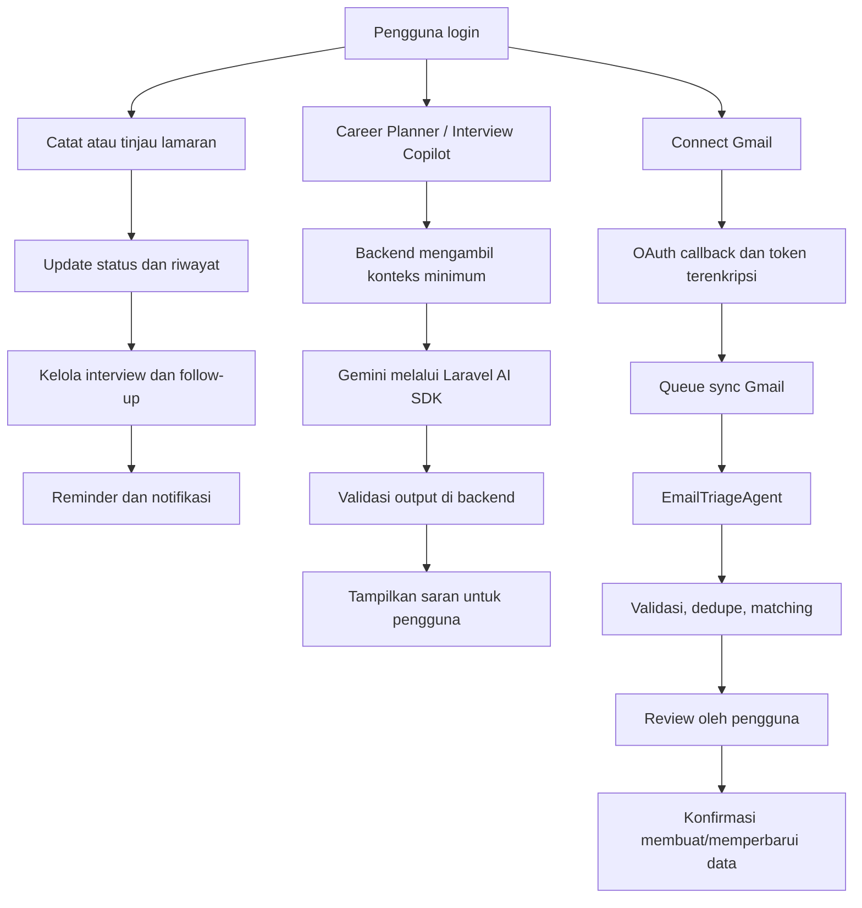
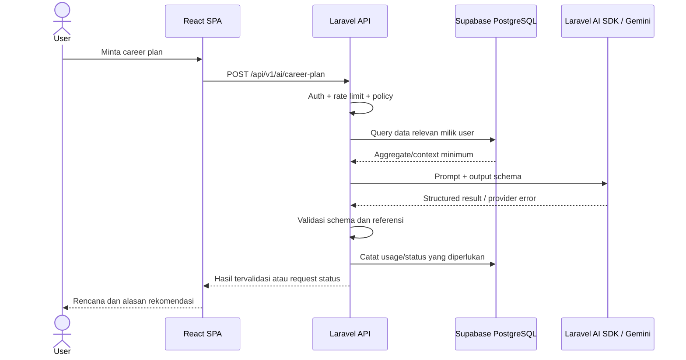
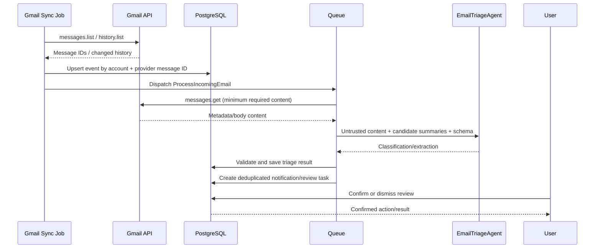
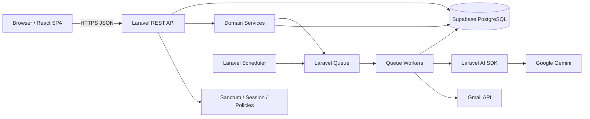
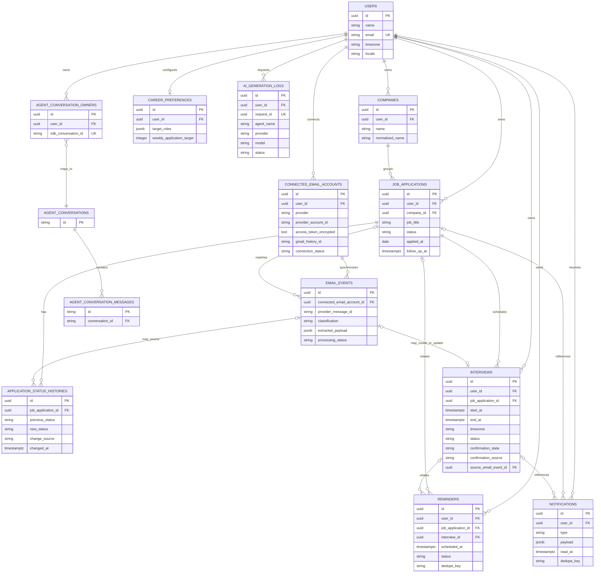
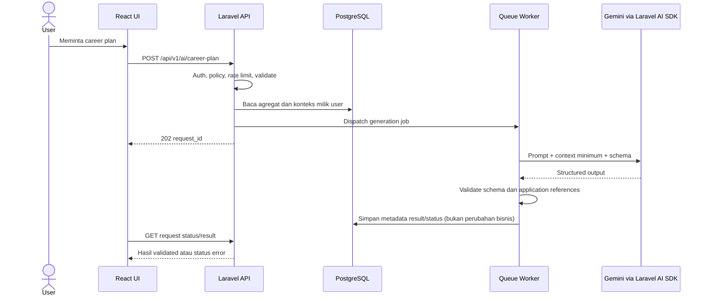
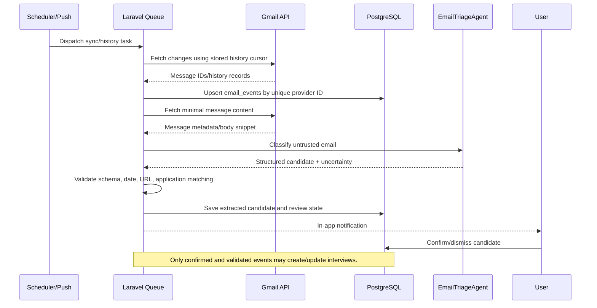

# Product Requirements Document (PRD) — CareerPilot AI

> **Status:** Draft untuk implementasi dan technical review  
> **Versi dokumen:** 1.0.0  
> **Tanggal:** 20 Oktober 2026  
> **Pemilik produk:** Product / Engineering  
> **Bahasa produk awal:** Bahasa Indonesia  
> **Jenis dokumen:** Product Requirements Document dan technical specification  
> **Prinsip status:** Kebutuhan yang belum dibuktikan ditandai sebagai **Asumsi**, **Usulan**, atau **Open Decision**; dokumen ini tidak menyatakan aplikasi telah diimplementasikan atau diuji.

## Daftar Isi

1. [Document Control](#1-document-control)
2. [Executive Summary](#2-executive-summary)
3. [Product Overview](#3-product-overview)
4. [Problem Statement](#4-problem-statement)
5. [Vision, Mission, and Value Proposition](#5-vision-mission-and-value-proposition)
6. [Goals and Non-Goals](#6-goals-and-non-goals)
7. [Target Users and Personas](#7-target-users-and-personas)
8. [User Pain Points](#8-user-pain-points)
9. [Product Scope](#9-product-scope)
10. [MVP vs Post-MVP](#10-mvp-vs-post-mvp)
11. [Product Principles](#11-product-principles)
12. [User Stories](#12-user-stories)
13. [User Journeys](#13-user-journeys)
14. [Information Architecture](#14-information-architecture)
15. [UI/UX Requirements](#15-uiux-requirements)
16. [Functional Requirements](#16-functional-requirements)
17. [Business Rules](#17-business-rules)
18. [User and System Workflows](#18-user-and-system-workflows)
19. [Technical Architecture](#19-technical-architecture)
20. [Technology Stack](#20-technology-stack)
21. [Repository and Folder Structure](#21-repository-and-folder-structure)
22. [Database Design](#22-database-design)
23. [ERD](#23-erd)
24. [Entity and Data Dictionary](#24-entity-and-data-dictionary)
25. [API Specification](#25-api-specification)
26. [Laravel AI SDK and Gemini Design](#26-laravel-ai-sdk-and-gemini-design)
27. [Gmail OAuth and Email Synchronization](#27-gmail-oauth-and-email-synchronization)
28. [Notification and Reminder System](#28-notification-and-reminder-system)
29. [Security, Privacy, and Compliance](#29-security-privacy-and-compliance)
30. [Non-Functional Requirements](#30-non-functional-requirements)
31. [Testing Strategy](#31-testing-strategy)
32. [Success Metrics and Analytics](#32-success-metrics-and-analytics)
33. [Acceptance Criteria](#33-acceptance-criteria)
34. [Implementation Roadmap](#34-implementation-roadmap)
35. [Risks and Mitigations](#35-risks-and-mitigations)
36. [Assumptions and Open Decisions](#36-assumptions-and-open-decisions)
37. [Definition of Done](#37-definition-of-done)
38. [Traceability Matrix](#38-traceability-matrix)
39. [Glossary](#39-glossary)
40. [Official Documentation References](#40-official-documentation-references)

---

## 1. Document Control

### 1.1 Tujuan dokumen

Dokumen ini menjadi _single source of truth_ untuk tujuan produk, ruang lingkup MVP, perilaku sistem, kontrak API, model data, integrasi pihak ketiga, keamanan, pengujian, dan kriteria penerimaan CareerPilot AI. Semua perubahan requirement setelah persetujuan awal harus diperbarui pada dokumen ini atau melalui perubahan yang ditautkan ke dokumen ini.

### 1.2 Riwayat versi

| Versi | Tanggal    | Perubahan                                                                                                      |
| ----- | ---------- | -------------------------------------------------------------------------------------------------------------- |
| 1.0.0 | 2026-10-20 | Konsolidasi requirement produk, arsitektur, database, integrasi AI/Gmail, security, testing, dan roadmap awal. |

### 1.3 Pemangku kepentingan

| Peran                        | Tanggung jawab                                                                              |
| ---------------------------- | ------------------------------------------------------------------------------------------- |
| Product Owner                | Menyetujui scope, prioritas, definisi metrik, dan trade-off produk.                         |
| Product/UX Designer          | Menyusun user flow, wireframe, usability testing, dan aksesibilitas.                        |
| Frontend Engineer            | Membangun React SPA, state handling, validasi tampilan, dan integrasi API.                  |
| Backend Engineer             | Membangun domain Laravel, API, authorization, data model, queues, dan scheduler.            |
| AI Engineer/Backend Engineer | Mengelola agent, prompt, structured output, evaluasi, dan batas penggunaan.                 |
| QA Engineer                  | Menurunkan requirement menjadi test case dan menjalankan regression serta acceptance tests. |
| Security/Privacy Reviewer    | Menilai OAuth scopes, pemrosesan data, retensi, threat model, dan kesiapan produksi.        |

### 1.4 Definisi prioritas

- **P0 — MVP wajib:** tanpa requirement ini, alur utama produk tidak layak dirilis.
- **P1 — MVP penting:** termasuk MVP jika kapasitas dan ketergantungan memungkinkan; sebelum rilis publik harus diputuskan secara eksplisit.
- **P2 — Post-MVP/peningkatan:** dapat ditunda tanpa menghambat nilai inti MVP.

### 1.5 Terminologi keputusan

- **Confirmed requirement:** keputusan yang dinyatakan eksplisit dalam PRD.
- **Usulan:** target teknis/produk yang perlu diverifikasi sebelum dianggap sebagai hasil terukur.
- **Asumsi:** keputusan sementara untuk memungkinkan rancangan bergerak maju.
- **OPEN DECISION:** pilihan yang memerlukan keputusan pemilik produk atau review teknis.

---

## 2. Executive Summary

CareerPilot AI adalah aplikasi pengelolaan pencarian kerja pribadi yang menyatukan pelacakan lamaran, jadwal interview, pengingat, notifikasi, perencanaan karier berbantuan AI, persiapan interview, analitik, serta triase email Gmail. Produk ditujukan bagi fresh graduate, jobseeker aktif, dan profesional yang berpindah pekerjaan.

Aplikasi dirancang sebagai **AI-assisted, bukan AI-controlled**. Laravel menjadi satu-satunya backend yang menjalankan business logic dan mengakses Supabase PostgreSQL. React + TypeScript + Vite menjadi frontend. Laravel AI SDK mengintegrasikan Google Gemini untuk pembuatan rencana, persiapan interview, insight, dan klasifikasi email. Gmail terhubung melalui OAuth; email diproses secara semiotomatis dan hasil yang ambigu harus ditinjau pengguna sebelum mengubah data penting.

MVP berfokus pada alur yang tetap berguna ketika AI atau Gmail tidak tersedia: pengguna tetap dapat mencatat lamaran, memperbarui status, mengelola interview, menerima reminder, dan melihat analitik dari data tersimpan. Integrasi email serta AI mempercepat pekerjaan administrasi, tetapi tidak menjadi sumber kebenaran tunggal untuk status atau kalender.

### 2.1 Hasil utama yang diharapkan

1. Pengguna dapat melihat status dan tindakan berikutnya untuk seluruh lamaran dari satu tempat.
2. Jadwal interview, deadline, dan follow-up memiliki alur pengingat yang dapat diaudit dan tidak duplikatif.
3. Informasi relevan dari email Gmail dapat ditemukan dan disarankan menjadi tindakan, dengan konfirmasi yang tepat.
4. AI menghasilkan bantuan yang relevan, terstruktur, dapat dijelaskan secara wajar, dan tidak mengarang fakta produk.
5. Data pribadi tetap terlindungi melalui otorisasi server-side, minimisasi data, dan pengelolaan OAuth yang aman.

### 2.2 Batas dokumen

PRD ini tidak berisi implementasi source code aplikasi, tidak mengklaim telah melewati pengujian, tidak menjamin akurasi AI, dan tidak mengasumsikan persetujuan produksi Google OAuth. Endpoint dan skema adalah kontrak yang direncanakan dan harus diuji terhadap dependency aktual.

---

## 3. Product Overview

### 3.1 Deskripsi produk

CareerPilot AI adalah personal job-search management platform yang menyimpan satu catatan kerja untuk setiap lamaran, menghubungkannya dengan status, aktivitas, interview, reminder, dan komunikasi email yang relevan. Produk menyediakan tampilan daftar, Kanban, kalender, pusat notifikasi, serta alat AI yang memanfaatkan konteks pengguna yang diizinkan.

### 3.2 Target users

- Fresh graduate dan first-time jobseekers yang baru mulai mencari pekerjaan.
- Jobseeker aktif yang mengelola puluhan hingga ratusan lamaran.
- Experienced professionals yang mencari pekerjaan sambil tetap bekerja atau sedang melakukan career transition.

### 3.3 Batas produk

- CareerPilot AI mengelola perjalanan pencarian kerja kandidat, bukan workflow rekrutmen perusahaan.
- Gmail adalah integrasi email awal; Microsoft Outlook berada di luar MVP.
- Semua data privat diakses melalui API Laravel, bukan akses langsung frontend ke Supabase Data API.
- AI dapat menyarankan dan menyusun draft. Perubahan penting pada status dan kalender harus mengikuti business rules dan confirmation workflow.

### 3.4 Konsep inti

| Konsep          | Definisi                                                                                                               |
| --------------- | ---------------------------------------------------------------------------------------------------------------------- |
| Job Application | Catatan posisi yang telah disimpan atau sudah dilamar, memiliki status pipeline dan riwayat perubahan.                 |
| Interview       | Sesi seleksi yang terkait dengan satu lamaran; dibuat manual atau setelah ekstraksi email dikonfirmasi.                |
| Email Event     | Pesan Gmail yang relevan bagi pencarian kerja beserta metadata/proses triase; bukan salinan permanen seluruh mailbox.  |
| Reminder        | Jadwal pengingat idempotent untuk interview, follow-up, deadline, atau tugas pengguna.                                 |
| AI Generation   | Satu permintaan AI dengan agent, versi prompt, status, metadata provider, dan hasil yang diperlukan untuk ditampilkan. |

---

## 4. Problem Statement

### 4.1 Problem A — Fragmented Application Tracking

Pengguna mengirim lamaran melalui portal dan website perusahaan yang berbeda. Informasi perusahaan, posisi, tanggal, status, dan langkah selanjutnya tersebar di email, spreadsheet, bookmark, atau ingatan. Akibatnya, pengguna sulit memperoleh gambaran terkini dan dapat membuat catatan ganda.

### 4.2 Problem B — Missed HR Communication

Undangan interview, permintaan dokumen, perubahan jadwal, penolakan, dan konfirmasi aplikasi dapat bercampur dengan email lain. Pengguna berisiko terlambat mengetahui pesan penting atau tidak menghubungkannya dengan lamaran yang benar.

### 4.3 Problem C — Missed Deadlines and Follow-ups

Pengguna mungkin lupa mengonfirmasi jadwal, menyelesaikan assessment, mengirim dokumen, atau melakukan follow-up yang sesuai.

### 4.4 Problem D — Poor Prioritization

Ketika banyak lamaran berlangsung serentak, pengguna membutuhkan cara praktis untuk memahami mana yang perlu ditangani hari ini, tanpa membuat AI mengambil alih keputusan.

### 4.5 Problem E — Insufficient Career Feedback

Tanpa data terstruktur, pengguna sulit mengukur aktivitas lamaran, sumber yang digunakan, respons, interview, status yang terlalu lama tidak berubah, serta progres menuju target mingguan.

### 4.6 Product opportunity

Menggabungkan pencatatan, kalender, pengingat, email triage, dan bantuan AI dalam satu alur yang saling terhubung. Nilai produk berasal dari pengurangan beban administratif dan visibilitas proses, bukan dari janji keberhasilan perekrutan.

### 4.7 Validasi masalah vs hipotesis pasar

Masalah di atas adalah **hipotesis masalah produk** yang perlu diuji melalui wawancara, analisis workflow, dan usability testing. PRD ini tidak mengklaim besaran pasar, persentase pengguna terdampak, atau penghematan waktu tanpa penelitian empiris.

---

## 5. Vision, Mission, and Value Proposition

### 5.1 Vision

**Helping every jobseeker manage their entire job-search journey with clarity, confidence, and AI-powered assistance.**

### 5.2 Visi dalam Bahasa Indonesia

Membantu setiap pencari kerja mengelola seluruh perjalanan pencarian kerja dengan lebih terorganisasi, terarah, dan terbantu oleh AI.

### 5.3 Mission

Menyediakan satu ruang kerja personal yang akurat, aman, dan sederhana untuk mengelola lamaran, komunikasi rekrutmen, jadwal, dan langkah karier berikutnya.

### 5.4 Value proposition

- Semua lamaran dan status berada di satu tempat.
- Tindakan berikutnya dan agenda interview terlihat jelas.
- Email rekrutmen yang relevan dapat disarankan sebagai event yang dapat ditinjau.
- AI membantu perencanaan dan persiapan tanpa mengambil keputusan penting secara sepihak.
- Analitik dihitung dari data sistem yang nyata serta memiliki definisi yang transparan.

---

## 6. Goals and Non-Goals

### 6.1 Goals

1. Menjadikan pencatatan dan pemantauan lamaran inti mudah digunakan dari desktop maupun mobile.
2. Menyediakan status pipeline dan audit history yang konsisten.
3. Mengurangi risiko lupa interview/follow-up melalui reminder yang idempotent.
4. Memungkinkan koneksi Gmail read-only dengan mekanisme sinkronisasi yang dapat dipulihkan.
5. Menghasilkan AI career plan dan materi interview berdasarkan konteks terotorisasi.
6. Menyajikan metrik yang dapat ditelusuri kembali ke data sumber.
7. Menjaga operasi CRUD inti tetap berjalan meskipun provider AI atau Gmail sedang gagal.

### 6.2 Non-goals MVP

- Menjadi ATS atau CRM rekrutmen milik perusahaan.
- Scraping otomatis seluruh job board atau menjamin kompatibilitas dengan semua portal.
- Mengirim email atas nama pengguna secara otomatis.
- Menjamin email HRD selalu dikenali atau semua tanggal dapat diekstrak.
- Menebak alasan penolakan tanpa bukti eksplisit.
- Menjamin pengguna mendapatkan pekerjaan.
- Menyinkronkan Google Calendar atau Outlook pada rilis awal.
- Menerapkan vector database/RAG sebelum ada use case terukur yang membutuhkannya.

### 6.3 Indikator goal tercapai

Keberhasilan dinilai melalui aktivasi, penggunaan mingguan, kelengkapan pencatatan, keandalan reminder, akurasi klasifikasi yang diukur pada data berlabel, dan feedback pengguna. Definisi operasional ada pada Bagian 32.

---

## 7. Target Users and Personas

### 7.1 Persona A — Fresh Graduate

| Aspek                 | Deskripsi                                                                                                              |
| --------------------- | ---------------------------------------------------------------------------------------------------------------------- |
| Konteks               | Baru memasuki pasar kerja dan belajar menjalankan proses pencarian kerja.                                              |
| Goals                 | Melacak lamaran, mengetahui proses yang sedang berjalan, mempersiapkan interview, membangun rutinitas pencarian kerja. |
| Pain points           | Belum memiliki sistem pencatatan, kurang yakin kapan melakukan follow-up, sulit memprioritaskan tugas.                 |
| Workflow umum         | Menyimpan lowongan, mengirim lamaran, mencatat status, mengikuti reminder, menggunakan AI untuk checklist dan latihan. |
| Nilai yang diharapkan | Struktur yang jelas dan bantuan praktis tanpa memerlukan pengetahuan teknis.                                           |
| Fitur relevan         | Onboarding, application CRUD, Kanban, reminder, Career Planner, Interview Copilot.                                     |
| Kriteria sukses       | Dapat membuat lamaran pertama, memahami status, dan menyiapkan langkah selanjutnya tanpa bantuan eksternal.            |

### 7.2 Persona B — Active Jobseeker

| Aspek                 | Deskripsi                                                                                              |
| --------------------- | ------------------------------------------------------------------------------------------------------ |
| Konteks               | Sedang melamar pada banyak perusahaan dan memiliki beberapa proses seleksi aktif.                      |
| Goals                 | Melihat pipeline, menghindari duplikasi, tidak melewatkan interview dan follow-up, mengukur progres.   |
| Pain points           | Volume data tinggi, status cepat berubah, email penting mudah tertimbun, jadwal berpotensi bentrok.    |
| Workflow umum         | Memfilter lamaran, memperbarui status, memeriksa email triage, mengonfirmasi event, melihat statistik. |
| Nilai yang diharapkan | Penghematan administrasi dan visibilitas terhadap banyak lamaran.                                      |
| Fitur relevan         | Search/filter/pagination, Kanban, Gmail integration, notification center, analytics.                   |
| Kriteria sukses       | Menemukan lamaran atau agenda yang diperlukan dengan cepat dan tidak menerima event/reminder ganda.    |

### 7.3 Persona C — Working Professional

| Aspek                 | Deskripsi                                                                                                         |
| --------------------- | ----------------------------------------------------------------------------------------------------------------- |
| Konteks               | Tetap bekerja sambil mencari peluang baru atau melakukan career transition.                                       |
| Goals                 | Menangani pencarian kerja secara selektif dan rahasia, menggunakan waktu terbatas dengan efektif.                 |
| Pain points           | Waktu terbatas, banyak konteks pekerjaan, kebutuhan privasi tinggi, interview perlu dikelola di luar jam kerja.   |
| Workflow umum         | Mencatat peluang terpilih, menentukan prioritas, memblokir waktu untuk persiapan, meninjau Gmail secara selektif. |
| Nilai yang diharapkan | Kontrol data, reminder yang tepat waktu, AI yang menghormati preferensi dan konteks minimum.                      |
| Fitur relevan         | Privacy controls, timezone-aware calendar, reminder, Career Planner, Gmail disconnect, analytics.                 |
| Kriteria sukses       | Dapat mengelola proses secara diskret dan terorganisasi tanpa perubahan data otomatis yang tidak diinginkan.      |

---

## 8. User Pain Points

| ID    | Pain point                 | Dampak yang harus dikurangi                          | Respons produk                                                       |
| ----- | -------------------------- | ---------------------------------------------------- | -------------------------------------------------------------------- |
| UP-01 | Catatan lamaran terpencar  | Data tidak lengkap, duplikasi, sulit mencari status  | Application CRUD, search, filters, status history                    |
| UP-02 | Pesan rekrutmen tenggelam  | Undangan atau permintaan penting terlambat diketahui | Gmail sync, email triage, notifications                              |
| UP-03 | Lupa agenda/follow-up      | Missed interview atau deadline                       | Reminder scheduler, kalender, due tasks                              |
| UP-04 | Sulit memilih prioritas    | Waktu dihabiskan pada tugas kurang mendesak          | Career Planner dengan alasan dan referensi data                      |
| UP-05 | Progres tidak terukur      | Sulit menilai pipeline dan rutinitas                 | Analytics dengan denominator dan rentang waktu jelas                 |
| UP-06 | Informasi AI keliru        | Status/jadwal bisa berubah tanpa dasar               | Structured output, server validation, review, audit history          |
| UP-07 | Kekhawatiran privasi email | Pengguna enggan menyambungkan akun                   | Scope minim, consent jelas, token terenkripsi, disconnect dan delete |

---

## 9. Product Scope

### 9.1 Area produk

1. Identitas, profil, preferensi, dan timezone.
2. Lamaran, perusahaan, status history, catatan, dan follow-up.
3. Dashboard, list, filtering, search, pagination, dan Kanban.
4. Kalender interview dan pengingat.
5. Notification center.
6. AI Career Planner.
7. AI Interview Copilot.
8. Gmail OAuth dan email triage semiotomatis.
9. Analytics dasar.
10. Logging, limits, testing, observability, dan security controls.

### 9.2 Scope fungsional email

Gmail dibaca menggunakan scope paling minimal yang memungkinkan use case aktual. **Usulan awal:** `https://www.googleapis.com/auth/gmail.readonly`. Scope tersebut diklasifikasikan Google sebagai restricted pada dokumentasi scope yang ditinjau; konsekuensi verifikasi dan security assessment harus dinilai sebelum produksi. Scope tidak mencakup pengiriman atau balasan email.

### 9.3 Explicitly out of scope

- Automatic email send/reply.
- Automatic destructive mailbox actions.
- Guaranteed extraction of all HR email.
- Fully automated status changes from unconfirmed email.
- Google Calendar sync in MVP.
- Microsoft Graph/Outlook in MVP.
- Cross-portal scraping.
- Employer/admin ATS features.

---

## 10. MVP vs Post-MVP

| Fitur                                    | Prioritas | Rilis           | Catatan                                                         |
| ---------------------------------------- | --------- | --------------- | --------------------------------------------------------------- |
| Authentication, profile, preferences     | P0        | MVP             | Sanctum SPA cookie session jika domain mendukung.               |
| Application CRUD dan status history      | P0        | MVP             | Inti produk dan tetap berfungsi tanpa AI.                       |
| List/search/filter/pagination dan Kanban | P0        | MVP             | Harus nyaman untuk puluhan hingga ratusan data.                 |
| Dashboard metrics dasar                  | P0        | MVP             | Dihitung dari query database.                                   |
| Interview CRUD/calendar                  | P0        | MVP             | Timezone-aware, terkait dengan lamaran.                         |
| Reminders dan notification center        | P0        | MVP             | Idempotency dan status delivery.                                |
| CareerPlannerAgent                       | P0        | MVP             | Output berstruktur, konteks minimal.                            |
| InterviewPrepAgent                       | P0        | MVP             | Output sebagai saran, bukan fakta perusahaan.                   |
| Gmail OAuth dan disconnect               | P0        | MVP             | Produksi bergantung pada verifikasi/policy review.              |
| Initial + incremental Gmail sync         | P0        | MVP             | Polling/trigger terjadwal cukup untuk baseline.                 |
| EmailTriageAgent dan review workflow     | P0        | MVP             | Jangan melakukan perubahan penting secara diam-diam.            |
| Basic Career Analytics                   | P0        | MVP             | Definisi metrik eksplisit.                                      |
| Pub/Sub push notification Gmail          | P1        | MVP+ / opsional | Polling fallback harus tetap tersedia.                          |
| Microsoft Outlook / Graph                | P2        | Post-MVP        | Provider adapter terpisah.                                      |
| Google Calendar sync                     | P2        | Post-MVP        | Conflict resolution dan OAuth scope baru perlu dirancang.       |
| Browser extension                        | P2        | Post-MVP        | Job capture, tanpa scraping massal.                             |
| Advanced resume/job matching             | P2        | Post-MVP        | Perlu evaluasi dan sumber job data.                             |
| Risk analysis lanjutan                   | P2        | Post-MVP        | Hanya berdasarkan sinyal dan batasan yang transparan.           |
| RAG/vector search                        | P2        | Post-MVP        | Hanya setelah kebutuhan pencarian semantik terbukti.            |
| Mobile native app                        | P2        | Post-MVP        | API versioned memungkinkan pengembangan kemudian.               |
| Multi-provider AI                        | P2        | Post-MVP        | Jangan menambah kompleksitas sebelum provider utama dievaluasi. |

### 10.1 Dependency order

Authentication dan ownership harus ada sebelum resource privat. Schema application harus tersedia sebelum interview, analytics, email matching, dan AI planning. Reminder engine dan notification center harus selesai sebelum alur deadline. Gmail OAuth harus berhasil sebelum sync; sync harus idempotent sebelum AI triage; email triage harus dapat ditinjau sebelum email-triggered scheduling diaktifkan.

---

## 11. Product Principles

1. **User-centric:** semua fitur harus menjawab kebutuhan nyata jobseeker.
2. **AI-assisted, not AI-controlled:** AI memberi saran, ringkasan, klasifikasi, dan draft. Backend rules dan pengguna mengendalikan perubahan penting.
3. **Data accuracy first:** tidak mengarang status, tanggal, perusahaan, nilai analitik, atau alasan penolakan.
4. **Privacy by design:** minimisasi pengambilan dan penyimpanan data email; token dan data sensitif dilindungi.
5. **Incremental delivery:** selesaikan CRUD dan kalender sebelum otomatisasi kompleks.
6. **Modular architecture:** domain aplikasi, email, reminder, AI, dan analytics dapat diuji terpisah.
7. **Traceability:** requirement terhubung dengan API, data, acceptance criteria, dan tes.
8. **Graceful degradation:** kegagalan Gemini/Gmail tidak boleh mengganggu CRUD inti.
9. **Explainable recommendations:** alasan rekomendasi ditampilkan dan dibedakan dari fakta.
10. **Human review at risk boundaries:** tanggal ambigu, lamaran yang tidak pasti, atau tindakan eksternal memerlukan review.

---

## 12. User Stories

| ID    | User story                                                                                                                             | Prioritas |
| ----- | -------------------------------------------------------------------------------------------------------------------------------------- | --------- |
| US-01 | Sebagai pengguna, saya ingin membuat akun dan mengatur timezone agar agenda serta reminder sesuai waktu lokal saya.                    | P0        |
| US-02 | Sebagai jobseeker, saya ingin menyimpan dan memperbarui data lamaran agar semua peluang tercatat di satu tempat.                       | P0        |
| US-03 | Sebagai jobseeker, saya ingin mengubah status dengan riwayat agar perkembangan tiap lamaran dapat ditelusuri.                          | P0        |
| US-04 | Sebagai jobseeker dengan banyak lamaran, saya ingin mencari dan memfilter data agar dapat menemukan item yang dibutuhkan dengan cepat. | P0        |
| US-05 | Sebagai pengguna, saya ingin melihat pipeline dan aktivitas berikutnya agar saya tahu apa yang harus dilakukan.                        | P0        |
| US-06 | Sebagai pengguna, saya ingin menjadwalkan interview dan reschedule agar agenda saya akurat.                                            | P0        |
| US-07 | Sebagai pengguna, saya ingin menerima reminder yang tidak ganda agar tidak melewatkan deadline.                                        | P0        |
| US-08 | Sebagai pengguna, saya ingin menghubungkan Gmail read-only agar pesan rekrutmen relevan dapat ditemukan.                               | P0        |
| US-09 | Sebagai pengguna, saya ingin meninjau ekstraksi email sebelum menjadi event penting agar kesalahan AI tidak mengubah data saya.        | P0        |
| US-10 | Sebagai pengguna, saya ingin AI menyusun rencana berdasarkan lamaran dan preferensi saya agar aktivitas lebih terarah.                 | P0        |
| US-11 | Sebagai kandidat, saya ingin latihan interview yang terkait dengan lowongan agar persiapan saya lebih relevan.                         | P0        |
| US-12 | Sebagai jobseeker, saya ingin melihat analitik dengan rumus transparan agar dapat mengevaluasi progres.                                | P0        |
| US-13 | Sebagai pengguna, saya ingin memutus koneksi Gmail dan menghapus data integrasi agar tetap memiliki kontrol atas data saya.            | P0        |
| US-14 | Sebagai pengguna, saya ingin menggunakan aplikasi meskipun AI atau Gmail gagal agar pencatatan tidak terhenti.                         | P0        |
| US-15 | Sebagai pengguna, saya ingin membandingkan progres dengan target mingguan yang saya atur.                                              | P1        |
| US-16 | Sebagai pengguna, saya ingin mendapatkan insight lanjutan lintas periode berdasarkan metrik yang tersedia.                             | P1        |

---

## 13. User Journeys

### 13.1 Journey A — Mencatat Lamaran

**Preconditions:** pengguna telah login.

**Primary flow:** pengguna membuka _My Applications_ dan memilih **Tambah Lamaran**; form menampilkan company, job title, employment type, location, description, source, source URL, salary range/currency, applied date, status, notes, dan follow-up date. Pengguna mengisi data. Field wajib minimum adalah nama perusahaan dan job title; untuk posisi yang benar-benar dilamar, applied date diwajibkan kecuali status `saved`. Frontend memberi validasi awal; backend memvalidasi ulang. Laravel melakukan transaksi untuk membuat/menggunakan company milik user, menyimpan application, dan mencatat status history awal. Sistem memperbarui list/dashboard dari API.

**Alternate/error flows:** URL tidak valid memberi error field; bila nama perusahaan dan posisi mirip terdeteksi, tampilkan duplicate warning dan opsi lanjut atau membuka rekaman lama; error database mempertahankan input; kegagalan AI tidak memengaruhi penyimpanan.

**Business rules:** status awal `saved` untuk peluang yang belum dikirim; status `applied` mensyaratkan tanggal aplikasi; duplikasi hanya peringatan karena dua lamaran serupa dapat sah.

**Acceptance criteria:** satu submit sukses membuat tepat satu application dan satu initial history row; payload invalid mendapat `422`; user tidak dapat menautkan company milik user lain.

### 13.2 Journey B — Mengelola Banyak Lamaran

**Preconditions:** pengguna mempunyai setidaknya satu application.

**Primary flow:** dashboard → pilih filter/search → buka detail → lihat status history dan kegiatan terkait → ubah status atau follow-up date → server memvalidasi transisi → simpan history dan audit event → tampilkan feedback dan data terbaru.

**Alternate/error flows:** hasil kosong menampilkan empty state yang berbeda dari error jaringan; record yang sudah dihapus mengembalikan `404`; transisi ilegal menghasilkan `422`; data stale dapat menghasilkan `409` jika optimistic concurrency digunakan.

**Acceptance criteria:** filter dapat dikombinasikan; pagination/sorting deterministik; setiap status change sukses memiliki history row baru; kegagalan tidak mengubah history.

### 13.3 Journey C — Menjadwalkan Interview Manual

**Preconditions:** pengguna login dan application terkait tersedia.

**Primary flow:** pilih lamaran → tambah interview → isi tipe, start/end time, IANA timezone, lokasi/meeting URL dan reminder preferences → server memvalidasi waktu → simpan interview dalam UTC dan simpan timezone asal → buat reminder dengan dedupe key → tampilkan pada kalender dan detail lamaran.

**Alternate/error flows:** end tidak lebih besar dari start; waktu lokal ambigu/tidak valid meminta konfirmasi; reschedule membatalkan reminder lama dan membuat jadwal baru; interview yang dibatalkan tidak mengirim reminder berikutnya.

**Acceptance criteria:** waktu tampil sesuai timezone yang dipilih; reschedule/cancel tidak menghasilkan reminder lama; double-submit tidak membuat event duplikat.

### 13.4 Journey D — Connect Gmail

**Preconditions:** pengguna login; Google OAuth client dan callback dikonfigurasi.

**Primary flow:** klik Connect Gmail → backend membuat `state` acak sekali pakai → browser diarahkan ke Google → pengguna menyetujui scope → callback Laravel memvalidasi `state`, code, redirect URI dan identitas akun → token ditukar di backend → token terenkripsi disimpan → status koneksi diperbarui → queue menjalankan initial sync → UI menampilkan status.

**Alternate/error flows:** consent ditolak; `state` tidak valid/kedaluwarsa; akun sudah terkoneksi; callback diulang; token refresh ditolak; scope berubah; Google API rate limit; pengguna disconnect atau revoke di akun Google.

**Acceptance criteria:** OAuth token tidak pernah dikembalikan ke frontend; callback invalid tidak membuat koneksi; koneksi tidak diduplikasi; sync failure dapat dicoba ulang tanpa event ganda.

### 13.5 Journey E — AI Email Detection

**Preconditions:** koneksi Gmail aktif dan pengguna menyetujui sinkronisasi.

**Primary flow:** sync job menemukan message ID baru → simpan `email_events` dengan unique provider ID/account → ambil metadata/body minimum dari Gmail → perlakukan konten sebagai input tidak tepercaya → EmailTriageAgent menghasilkan JSON sesuai schema → server memvalidasi field, enum, timestamp, URL dan uncertainty → matcher menghasilkan kandidat lamaran atau `unmatched` → event relevan menimbulkan notification/review item → pengguna meninjau → confirm/dismiss → hanya confirm dapat membuat interview atau melakukan perubahan yang disetujui.

**Alternate/error flows:** email bukan terkait kerja → `ignored`; tanggal tanpa timezone → ambiguous; kandidat lamaran lebih dari satu → user memilih; schema invalid → retry terbatas lalu `failed`; duplicate message ID → tidak diproses ulang; prompt injection → tidak memengaruhi hak tool.

**Acceptance criteria:** event provider unik; ekstraksi ambigu tidak membuat interview aktif; keputusan review tersimpan; notifikasi tidak ganda.

### 13.6 Journey F — AI Career Planning

**Preconditions:** pengguna login dan provider tersedia.

**Primary flow:** pengguna mengirim goal → backend mengambil ringkasan application aktif, interview mendatang, follow-up terlambat dan preferences relevan → context minimum dikirim ke agent → structured result diterima/divalidasi → backend memastikan semua application references milik user → hasil tampil sebagai rekomendasi dengan alasan dan prioritas.

**Alternate/error flows:** data kosong menghasilkan rencana awal yang tidak mengarang application references; timeout/provider error memberi status retryable; output invalid ditolak; hasil merefleksikan snapshot konteks saat request.

**Acceptance criteria:** AI hanya merujuk entitas terotorisasi; hasil tidak melakukan update tanpa konfirmasi; fungsi non-AI tetap tersedia saat provider gagal.

### 13.7 Journey G — AI Interview Preparation

**Preconditions:** application dipilih dan dimiliki pengguna.

**Primary flow:** pengguna memilih **Siapkan Interview** → backend mengambil job description dan catatan relevan → agent mengembalikan pertanyaan, kompetensi, checklist dan saran → server memvalidasi payload → frontend memungkinkan pengguna menyalin/menyimpan catatan.

**Alternate/error flows:** deskripsi pekerjaan kosong menghasilkan persiapan generik berdasarkan title dan diberi label; provider error menampilkan retry; hasil tidak mengklaim pengetahuan privat tentang perusahaan.

**Acceptance criteria:** output berkaitan dengan application terpilih; tidak mengubah status/event; saran dibedakan dari fakta yang diketahui.

---

## 14. Information Architecture

### 14.1 Navigasi utama

1. Dashboard
2. My Applications
3. Kanban Board
4. Interview Calendar
5. Notifications
6. AI Career Planner
7. Interview Copilot
8. Career Analytics
9. Connected Accounts
10. Profile and Settings

### 14.2 Hierarki halaman

| Halaman              | Tujuan                                | Tindakan utama                                            |
| -------------------- | ------------------------------------- | --------------------------------------------------------- |
| Dashboard            | Ringkasan pipeline dan tugas terdekat | Tambah lamaran, lihat interview, tangani follow-up        |
| My Applications      | Data lamaran dalam list               | Create/edit, search, filter, sort, buka detail            |
| Application Detail   | Satu lamaran dan riwayat relevan      | Update status, edit notes, tambah interview, follow-up    |
| Kanban Board         | Distribusi status                     | Pindahkan status dengan validasi dan feedback             |
| Interview Calendar   | Agenda interview                      | Create, reschedule, cancel, detail event                  |
| Notifications        | Review pesan sistem dan email triage  | Mark-read, buka item, confirm/dismiss triage              |
| Career Planner       | Rencana tugas berbasis konteks        | Generate, regenerate, salin checklist                     |
| Interview Copilot    | Materi persiapan per lamaran          | Generate questions, checklist, mock feedback              |
| Career Analytics     | Ringkasan tren dan pipeline           | Filter rentang tanggal, lihat definisi metrik             |
| Connected Accounts   | Pengelolaan Gmail                     | Connect, sync now, disconnect, lihat error                |
| Profile and Settings | Preferensi akun dan privasi           | Edit profile, timezone, reminder defaults, delete account |

### 14.3 Page states wajib

Setiap halaman yang mengambil data harus mendefinisikan loading/skeleton, empty, success, partial-data, error, permission-denied, dan stale-data state jika relevan. Empty state harus memberi tindakan berikutnya, bukan halaman kosong tanpa petunjuk.

---

## 15. UI/UX Requirements

### 15.1 Prinsip layout

- Desktop: sidebar navigasi, header dengan aksi kontekstual, konten utama yang menjaga keterbacaan.
- Mobile: navigasi mudah dijangkau; tabel beralih menjadi card/list atau horizontal-scroll terkendali; form tidak membutuhkan hover.
- Bahasa UI default Bahasa Indonesia; struktur i18n memungkinkan bahasa lain.
- Status tidak dibedakan oleh warna saja; gunakan label teks dan ikon.

### 15.2 Forms

- Label eksplisit dan helper text untuk format/konsekuensi.
- Validasi client-side menggunakan Zod untuk feedback awal; Laravel Form Requests adalah sumber aturan akhir.
- Field error tampil dekat field; error umum tidak membuang input.
- Tindakan destruktif menggunakan confirmation modal dengan target yang jelas.
- Tanggal tanpa timezone pasti tidak boleh diam-diam dianggap sebagai waktu lokal yang akurat.

### 15.3 List dan Kanban

- Pagination wajib; default `per_page=20`, maksimum awal `100` (usulan, perlu load test).
- Filter status, company, source, applied-date range, dan follow-up due dapat digabungkan.
- Sort default `updated_at desc`; key sorting dibatasi allowlist.
- Kanban mengikuti transisi status yang sama dengan detail application.
- Drag-and-drop memiliki alternatif keyboard/control menu.

### 15.4 Calendar

- Waktu tampil berdasarkan timezone yang terlihat/terpilih.
- Event yang menunggu review dibedakan dan tidak masuk kalender interview aktif sebelum dikonfirmasi.
- Reschedule memperlihatkan waktu lama dan waktu baru jika timezone berpotensi membingungkan.

### 15.5 AI UI

- Tampilkan bahwa output adalah rekomendasi AI.
- Sediakan regenerate (bila relevan), copy, dan feedback helpful/not helpful.
- Confidence tidak ditampilkan sebagai probabilitas akurat sebelum dikalibrasi dengan dataset berlabel.
- Provider error menawarkan retry aman tanpa stack trace/prompt internal.

### 15.6 Notification UX

- Unread marker, filter kategori, mark-read, dan deep link ke entity terotorisasi.
- Notifikasi hasil Gmail menjelaskan bahwa informasi diekstrak dan mungkin memerlukan review.
- Jangan tampilkan seluruh isi email sensitif dalam preview eksternal bila push ditambahkan kelak.

### 15.7 Accessibility

- Target desain WCAG 2.2 AA pada alur inti, dengan audit manual dan otomatis.
- Semua alur utama bisa dioperasikan dengan keyboard.
- Fokus terlihat; dialog mengelola fokus; toast menggunakan live region jika sesuai.
- Error tidak hanya ditandai dengan warna.

### 15.8 Contoh UI copy

- Empty application list: **“Belum ada lamaran. Tambahkan lamaran pertama untuk mulai melacak progres.”**
- Gmail ambiguous: **“Kami menemukan kemungkinan undangan interview, tetapi tanggal atau posisi belum cukup pasti. Periksa detail sebelum menambahkan ke kalender.”**
- AI unavailable: **“Asisten AI sedang tidak tersedia. Data lamaran dan kalender Anda tetap dapat digunakan.”**
- Disconnect: **“Memutus Gmail akan menghentikan sinkronisasi baru. Anda dapat memilih apakah metadata email yang sudah tersimpan juga dihapus.”**

---

## 16. Functional Requirements

Persyaratan berikut adalah kontrak yang direncanakan, bukan klaim bahwa pengujian telah dijalankan. Semua endpoint privat menurunkan identitas user dari session terautentikasi, bukan dari `user_id` di payload.

### 16.1 Authentication and Profile

#### FR-AUTH-001 — Registrasi dan login

- **Prioritas:** P0. **User story:** US-01.
- **Preconditions:** database dan session tersedia.
- **Perilaku:** pengguna dapat register, login, logout, membaca identitas sendiri, dan mengakses halaman privat dengan Laravel Sanctum SPA cookie session bila domain frontend/backend kompatibel.
- **Validasi/error:** email valid/unik; password mengikuti policy; kredensial salah memberikan pesan generik; request tanpa session valid mendapat `401`.
- **Acceptance:** login/logout berfungsi, session diinvalidasi saat logout, endpoint privat menolak request unauthenticated.
- **Dependencies:** users schema, HTTPS, session config.
- **Security/privacy:** CSRF, secure/HttpOnly cookie, rate limit login, tidak menyimpan token sesi di localStorage.

#### FR-AUTH-002 — Profil, timezone, dan preferences

- **Prioritas:** P0. **User story:** US-01.
- **Preconditions:** user terautentikasi.
- **Perilaku:** baca/update nama, timezone IANA, bahasa, preferensi reminder, target mingguan, dan career preferences.
- **Validasi/error:** timezone dikenal; preferences memiliki tipe/batas ukuran; invalid menghasilkan `422`.
- **Acceptance:** preferences tersimpan per user dan digunakan dalam rendering/scheduling.
- **Dependencies:** `career_preferences`, profile API.
- **Security/privacy:** user hanya dapat mengubah profil sendiri.

#### FR-AUTH-003 — Penghapusan akun

- **Prioritas:** P0 sebelum public release. **User story:** US-13.
- **Preconditions:** reauthentication jika tersedia dan konfirmasi eksplisit.
- **Perilaku:** stop Gmail, revoke token jika memungkinkan, hapus/anonimkan data sesuai policy, batalkan reminder/queued work, invalidasi session.
- **Validasi/error:** tanpa reauth/confirmation tidak boleh mengeksekusi; kegagalan revoke ditangani retry dan audit.
- **Acceptance:** akun tak dapat login kembali dan data mengikuti deletion policy; workflow idempotent.
- **Dependencies:** disconnect flow, retention policy, cascading rules.
- **Security/privacy:** log tidak menyimpan token/body; retensi backup dijelaskan.

#### FR-AUTH-004 — Export data pribadi

- **Prioritas:** P1. **User story:** US-13.
- **Preconditions:** user terautentikasi dan meminta export secara eksplisit.
- **Perilaku:** job asynchronous membuat arsip terstruktur atas data milik user yang dapat diekspor: profil/preferences, applications dan status history, interviews, reminders, notifications yang relevan, serta ringkasan email events. Raw email body dan OAuth tokens tidak pernah dimasukkan; AI logs hanya dimasukkan sebagai metadata minimal jika policy mengizinkan.
- **Validasi/error:** hanya satu request aktif per user atau permintaan dibatasi; link unduhan memiliki masa berlaku singkat dan pemilik diverifikasi; hasil export kedaluwarsa dihapus sesuai retention policy.
- **Acceptance:** user dapat melihat status queued/ready/failed dan mengunduh arsip miliknya saja; user lain tidak dapat mengakses file; expired link tidak berfungsi.
- **Dependencies:** ownership, queue, secure file storage, retention policy.
- **Security/privacy:** file export dienkripsi at rest sesuai storage capabilities; URL tidak ditulis penuh ke log; export tidak mencakup credential atau secrets.

### 16.2 Application Management

#### FR-APP-001 — Create dan read application

- **Prioritas:** P0. **User story:** US-02.
- **Preconditions:** user login.
- **Perilaku:** create/read company, title, employment type, location, description, source, URL, salary range/currency, applied date, status, notes, follow-up date. Field yang tidak diketahui/opsional boleh null.
- **Validasi/error:** company/title wajib; status enum valid; `salary_min <= salary_max`; applied date diperlukan untuk status `applied` dan seterusnya kecuali aturan khusus disetujui; URL valid; invalid mendapat `422`.
- **Acceptance:** transaksi membuat application dan initial history; hanya pemilik dapat melihat data.
- **Dependencies:** companies, applications, status histories.
- **Security/privacy:** ownership validation, output encoding, batas panjang.

#### FR-APP-002 — Update dan soft delete

- **Prioritas:** P0. **User story:** US-02.
- **Preconditions:** application aktif milik user.
- **Perilaku:** update field allowlisted dan soft delete; restore bukan syarat MVP kecuali direncanakan dan diaudit.
- **Validasi/error:** data orang lain tak boleh diungkap; `404` untuk resource di luar akses; concurrency conflict dapat menghasilkan `409`.
- **Acceptance:** history tetap utuh; soft-deleted item hilang dari default list; reminder terkait dibatalkan sesuai policy.
- **Dependencies:** policies, soft deletes.
- **Security/privacy:** query selalu scoped; `company_id` divalidasi ownership-nya.

#### FR-APP-003 — Status workflow dan audit history

- **Prioritas:** P0. **User story:** US-03.
- **Preconditions:** application aktif milik user.
- **Perilaku:** status diubah melalui endpoint khusus, divalidasi, dan disimpan dengan previous/new status, change source, notes, actor dan timestamp.
- **Validasi/error:** transisi ilegal `422`; deleted application `404`; request retry tidak boleh menambah history duplikat.
- **Acceptance:** setiap perubahan sukses memiliki history row; history hanya append melalui UI umum.
- **Dependencies:** status rules, DB transaction.
- **Security/privacy:** email dapat mengubah status hanya setelah konfirmasi dan rule yang disetujui.

#### FR-APP-004 — Search/filter/pagination/sort dan duplicate warning

- **Prioritas:** P0. **User story:** US-04.
- **Preconditions:** user login.
- **Perilaku:** search company/title; filter status/source/date/follow-up; pagination; sorting allowlisted; duplicate warning saat create.
- **Validasi/error:** `per_page` dibatasi; sort tidak dapat menjalankan arbitrary SQL; warning duplikat tidak memblokir rekaman sah.
- **Acceptance:** filter kombinasi konsisten, metadata pagination valid, empty result dibedakan dari error.
- **Dependencies:** indexes, list endpoint.
- **Security/privacy:** pencarian hanya pada dataset user.

#### FR-APP-005 — Dashboard dan Kanban

- **Prioritas:** P0. **User story:** US-05.
- **Preconditions:** user login.
- **Perilaku:** tampilkan saved, active, interviews, offers, rejections, upcoming interviews, follow-ups due, recent activity dan pipeline; Kanban membaca status database.
- **Validasi/error:** angka tidak berasal dari AI; definisi active/date range konsisten; move di Kanban memanggil status workflow.
- **Acceptance:** metrik dapat direkonsiliasi dengan query; kegagalan widget tidak merusak halaman keseluruhan.
- **Dependencies:** applications, interviews, reminders, notifications.
- **Security/privacy:** semua aggregate scoped ke user.

#### FR-INT-001 — Interview CRUD dan kalender

- **Prioritas:** P0. **User story:** US-06.
- **Preconditions:** application aktif milik user.
- **Perilaku:** create, read, update, cancel, complete; simpan `start_at`/`end_at` sebagai UTC `timestamptz`, simpan IANA timezone, interview type, meeting URL/location, status, `confirmation_state` yang ditentukan server, `confirmation_source`, dan optional source email event.
- **Validasi/error:** `end_at > start_at`; timezone valid; application ownership diperiksa; schedule conflict awalnya berupa warning.
- **Acceptance:** reschedule membatalkan reminder lama dan membuat reminder baru idempotent; event yang masih direview email bukan interview aktif.
- **Dependencies:** applications dan reminders.
- **Security/privacy:** meeting URL tidak dibagikan ke user lain.

#### FR-REM-001 — Reminder scheduling dan delivery

- **Prioritas:** P0. **User story:** US-07.
- **Preconditions:** reminder preferences/config tersedia.
- **Perilaku:** dukung interview, assessment deadline, follow-up, custom task, dan pending email review. Default usulan: H-1 hari dan H-2 jam untuk interview; konfigurasi dapat diubah pengguna.
- **Validasi/error:** reminder lewat tidak dikirim diam-diam; reschedule/cancel membatalkan pending job; delivery failure dicatat dan dapat di-retry.
- **Acceptance:** key unik/deterministik mencegah reminder ganda; pengiriman memperhitungkan timezone; target scheduler dipantau.
- **Dependencies:** Laravel queue/scheduler dan notifications.
- **Security/privacy:** teks reminder meminimalkan detail sensitif.

#### FR-NOTIF-001 — Notification center

- **Prioritas:** P0. **User story:** US-07, US-09.
- **Preconditions:** user login.
- **Perilaku:** list paginated, filter kategori, mark-as-read, detail, dan deep link dengan ownership check. Setiap notifikasi memiliki title/body/type, related entity, read time, JSONB payload, created time, dedupe key.
- **Validasi/error:** mark-read idempotent; payload tidak membuka URL arbitrer; item privat tidak bocor.
- **Acceptance:** unread count cocok dengan DB; notifikasi berulang untuk sumber event sama tidak muncul ganda.
- **Dependencies:** email events, reminders, application/interview models.
- **Security/privacy:** sanitasi payload dan redaksi preview.

### 16.3 AI Features

#### FR-AI-001 — AI Career Planner

- **Prioritas:** P0. **User story:** US-10.
- **Preconditions:** user terautentikasi dan memulai generate.
- **Perilaku:** ambil goal, ringkasan application aktif, interview mendatang, follow-up relevan, dan preferences; hasilkan summary, tugas terurut, alasan, priority, dan optional application references memakai structured output.
- **Validasi/error:** reference divalidasi server-side; timeout/rate limit retryable; data kosong memiliki fallback; AI tidak langsung mengubah data.
- **Acceptance:** hanya merujuk entitas milik user; kegagalan tidak mengubah data inti; prompt/model version tercatat.
- **Dependencies:** Laravel AI SDK, Gemini, application queries.
- **Security/privacy:** context minimum, tanpa secrets atau mailbox penuh, user-level limits.

#### FR-AI-002 — AI Interview Preparation

- **Prioritas:** P0. **User story:** US-11.
- **Preconditions:** application terpilih milik user.
- **Perilaku:** hasilkan pertanyaan interview, behavioral/situational prompts, kompetensi, checklist, summary deskripsi kerja berbasis data tersedia, dan feedback actionable/mock interview jika alur tersebut tersedia.
- **Validasi/error:** schema/panjang divalidasi; fakta yang tidak tersedia ditandai tidak diketahui; provider error dapat dicoba ulang.
- **Acceptance:** hasil berkaitan dengan application terpilih dan tidak mengubah status/interview; user menyimpan catatan secara eksplisit.
- **Dependencies:** Gemini/SDK, application data.
- **Security/privacy:** job description/notes adalah input tidak tepercaya; jangan mengarang fakta perusahaan.

#### FR-AI-003 — Structured output, usage limits, generation logs

- **Prioritas:** P0. **User story:** US-14.
- **Preconditions:** AI client configuration tersedia.
- **Perilaku:** machine-readable outputs menggunakan schema; server memvalidasi ulang; catat agent, provider/model, prompt version, status, latency, token usage bila tersedia, error category, request ID, dan result hanya bila dibutuhkan untuk polling/display.
- **Validasi/error:** retry terbatas dengan backoff; jangan retry input invalid; per-user rate/concurrency limit; error disanitasi.
- **Acceptance:** malformed output tidak menulis ke domain DB; log tidak berisi secrets atau raw email body secara default.
- **Dependencies:** SDK, logs, rate limiting.
- **Security/privacy:** retensi terbatas; prompt version tidak memuat credentials.

#### FR-AI-004 — Application insights/analytics explanation

- **Prioritas:** P1. **User story:** US-12, US-16.
- **Preconditions:** verified aggregates tersedia.
- **Perilaku:** AI menjelaskan tren, limitation, dan tindakan yang mungkin membantu berdasarkan aggregates backend.
- **Validasi/error:** angka authoritative berasal dari analytics service; model tidak mengganti angka; jangan menyimpulkan alasan rejection.
- **Acceptance:** angka dalam insight sama dengan analytics API; limitation ditampilkan untuk sampel kecil/cohort baru.
- **Dependencies:** analytics endpoint dan AI service.
- **Security/privacy:** jangan kirim data email/notes jika tidak relevan.

### 16.4 Gmail and Email Triage

#### FR-EMAIL-001 — Connect, refresh, disconnect Gmail

- **Prioritas:** P0. **User story:** US-08, US-13.
- **Preconditions:** OAuth client, HTTPS callback, consent copy dikonfigurasi.
- **Perilaku:** backend menangani authorization-code flow, `state`, code exchange, minimal scope, encrypted token storage, refresh, status koneksi, revoke/disconnect, dan sync trigger.
- **Validasi/error:** state one-time; callback code tak dapat dipakai ulang; refresh failure tandai `reauthorization_required`; disconnect menghentikan sync dan menghapus token.
- **Acceptance:** token tidak dikembalikan ke frontend; disconnect menghentikan sinkronisasi baru; reconnect memerlukan consent sesuai flow.
- **Dependencies:** Google OAuth dan email account schema.
- **Security/privacy:** scope read-only; verification/security assessment dinilai sebelum rilis publik.

#### FR-EMAIL-002 — Initial and incremental synchronization

- **Prioritas:** P0. **User story:** US-08.
- **Preconditions:** connected account aktif.
- **Perilaku:** initial sync mengambil pesan terbaru yang dibatasi; incremental sync memakai Gmail History API dan cursor `historyId`; cursor diperbarui secara konsisten setelah batch event tersimpan.
- **Validasi/error:** HTTP 404 karena cursor usang memicu controlled full resync; 401/invalid grant meminta reconnect; 429/5xx memakai backoff; duplicate event diredam constraint unique.
- **Acceptance:** retry tidak menduplikasi email event; sync status terlihat; batch pagination bisa dilanjutkan setelah error.
- **Dependencies:** Gmail API, queue, event table.
- **Security/privacy:** jangan mengambil/menyimpan seluruh mailbox tanpa kebutuhan; jangan log body email.

#### FR-EMAIL-003 — Triage, matching, dan review

- **Prioritas:** P0. **User story:** US-09.
- **Preconditions:** email event berasal dari account aktif.
- **Perilaku:** klasifikasi `interview_invitation`, `interview_reschedule`, `document_request`, `application_received`, `rejection`, `offer`, `follow_up`, `other`; extract sender/company/title, date/time/timezone, meeting URL, requested action, uncertainty, candidate application; user confirm/dismiss.
- **Validasi/error:** field yang tak diketahui boleh null; timezone ambiguous perlu review; multiple application candidates tidak dipilih paksa; invalid schema fail closed.
- **Acceptance:** event belum terkonfirmasi tidak membuat interview aktif/mengubah status; confirm/dismiss idempotent dan tercatat.
- **Dependencies:** EmailTriageAgent, applications, notifications, review UI.
- **Security/privacy:** email adalah untrusted input dan tidak boleh memengaruhi tool permissions.

#### FR-EMAIL-004 — Email push notification (opsional)

- **Prioritas:** P1. **User story:** US-08.
- **Preconditions:** Pub/Sub disetujui dan dikonfigurasi.
- **Perilaku:** webhook memverifikasi identitas push OIDC/audience, subscription/topic, mengambil `historyId`, kemudian enqueue history sync. Scheduled sync tetap menjadi fallback.
- **Validasi/error:** pesan invalid ditolak; payload push tidak dianggap isi email; duplicate push idempotent.
- **Acceptance:** watch diperbarui sebelum expiry; missed push bisa direkonsiliasi.
- **Dependencies:** Pub/Sub, Gmail watch, queue.
- **Security/privacy:** webhook tidak menerima perintah arbitrer atau Gmail tokens.

### 16.5 Analytics, Ownership, and Operations

#### FR-AN-001 — Basic career analytics

- **Prioritas:** P0. **User story:** US-12.
- **Preconditions:** application data atau empty state tersedia.
- **Perilaku:** hitung applications per period, pipeline, by source, response counts, interview conversion, overdue follow-ups, upcoming interviews, status aging, weekly target progress.
- **Validasi/error:** perhitungan dari DB; denominator/cohort didefinisikan; data kosong menjadi `0` atau `N/A` menurut metrik, bukan hasil rekaan AI.
- **Acceptance:** rumus lolos unit tests dan dapat ditelusuri.
- **Dependencies:** status histories, interviews, preferences.
- **Security/privacy:** query user-scoped dan tidak ada aggregate lintas akun di MVP.

#### FR-SEC-001 — Ownership and authorization enforcement

- **Prioritas:** P0. **User story:** US-14.
- **Preconditions:** setiap domain resource mempunyai ownership path.
- **Perilaku:** Laravel Policies/middleware/service scope memeriksa ownership pada semua read/write, termasuk nested resource, email review, AI references, deep links, integration accounts, dan conversations.
- **Validasi/error:** ID milik orang lain menghasilkan `404` atau `403` sesuai policy konsisten; payload tidak memilih owner.
- **Acceptance:** automated tests menunjukkan tidak ada akses lintas user.
- **Dependencies:** seluruh API privat.
- **Security/privacy:** defense in depth pada controller/service/query.

#### FR-OPS-001 — Queue, logging, and graceful failure

- **Prioritas:** P0. **User story:** US-14.
- **Preconditions:** queue, worker, logs, monitoring tersedia.
- **Perilaku:** Gmail sync, email triage, reminder delivery, dan task lambat berjalan asynchronous; status/retries/correlation ID tercatat.
- **Validasi/error:** failed jobs dapat ditinjau/retry; idempotency diterapkan; logs tak memuat token/password/raw body.
- **Acceptance:** provider failure tidak merusak data yang tersimpan; retry tidak membuat event/reminder ganda.
- **Dependencies:** queue infra, idempotency indexes, monitoring.
- **Security/privacy:** worker berhak minimum, log retention terbatas.

---

## 17. Business Rules

### 17.1 Status application

| Status       | Arti                                         | Perilaku utama                                                            |
| ------------ | -------------------------------------------- | ------------------------------------------------------------------------- |
| `saved`      | Posisi disimpan, belum tentu dilamar         | Tidak masuk count applied.                                                |
| `applied`    | Lamaran telah dikirim menurut pengguna       | Membutuhkan applied date.                                                 |
| `screening`  | Tahap screening/review awal                  | Aktif.                                                                    |
| `assessment` | Kandidat sedang menjalani assessment/test    | Aktif; deadline dapat dihubungkan.                                        |
| `interview`  | Sedang menjalani tahap interview             | Aktif; agenda rinci berada pada `interviews`.                             |
| `offer`      | Pengguna menerima informasi offer            | AI tidak boleh menyimpulkan offer tanpa bukti dan review yang diperlukan. |
| `rejected`   | Kandidat menerima penolakan                  | Terminal dalam alur normal.                                               |
| `withdrawn`  | Kandidat menarik lamaran/menolak melanjutkan | Terminal dalam alur normal.                                               |

**Transisi normal:** `saved` → `applied`/`withdrawn`; `applied` → `screening`/`assessment`/`interview`/`offer`/`rejected`/`withdrawn`; `screening` → `assessment`/`interview`/`offer`/`rejected`/`withdrawn`; `assessment` → `screening`/`interview`/`offer`/`rejected`/`withdrawn`; `interview` → `assessment`/`offer`/`rejected`/`withdrawn`; `offer` → `withdrawn` (contoh kandidat menolak offer; wajib catatan). `rejected` dan `withdrawn` adalah terminal alur normal. Reopen, jika disediakan, harus eksplisit, disertai alasan dan audit; bukan perubahan email otomatis.

Pengulangan status yang sama menjadi no-op tanpa history baru atau validation error adalah **OPEN DECISION**. Rekomendasi: no-op idempotent tanpa menambah history duplikat.

### 17.2 Saved position vs application sent

`saved` berarti peluang disimpan tetapi belum mengklaim sudah dilamar. `applied` berarti pengguna menyatakan lamaran dikirim. Mengunjungi URL atau menyimpan deskripsi tidak otomatis mengubah status menjadi `applied`.

### 17.3 Company normalization

Company record dimiliki user pada MVP. Backend dapat menormalisasi nama untuk menemukan company milik user yang sudah ada, tetapi tidak membagikan catatan company antar-user. Alias berbeda dapat tetap menjadi record berbeda setelah user review.

### 17.4 Interview creation and confirmation

- Interview manual yang dibuat pengguna menjadi `manual_entry`/confirmed.
- Email triage menyimpan saran pada `email_events`; event yang belum terkonfirmasi bukan interview aktif.
- Date/time tanpa timezone atau rentang waktu tak lengkap memerlukan user review.
- Confirm harus idempotent; konfirmasi kedua tidak membuat interview baru.

### 17.5 Timezone

- Simpan instan interview/reminder sebagai UTC dengan PostgreSQL `timestamptz`.
- Simpan IANA timezone, misalnya `Asia/Jakarta`, untuk interpretasi dan render.
- Default usulan ketika belum tersedia adalah `Asia/Jakarta`, tetapi timezone browser harus ditawarkan saat onboarding.
- Zona yang tidak disebut email boleh ditafsirkan memakai timezone user hanya sebagai saran dan perlu konfirmasi bila berdampak pada event.
- Offset statis bukan pengganti IANA timezone.

### 17.6 Reminder idempotency

Setiap reminder memiliki `dedupe_key` deterministik dari owner, entity/task identity, reminder kind, scheduled UTC instant dan rule version. Reschedule membatalkan reminder lama dan membuat reminder baru. Reminder yang telah terkirim tidak ditulis ulang untuk menyembunyikan riwayat.

### 17.7 Email event idempotency

Unique `(connected_email_account_id, provider_message_id)` adalah perlindungan utama. Pemrosesan boleh diulang; state transition harus atomic atau menggunakan lock agar dua worker tidak membuat dua review item/interview.

### 17.8 Analytics definitions

- **Total applications:** application aktif non-soft-deleted termasuk `saved`, kecuali metrik memiliki label berbeda.
- **Active applications:** status `applied`, `screening`, `assessment`, atau `interview`.
- **Response count:** jumlah unique application dengan sekurangnya satu komunikasi rekrutmen yang dikonfirmasi user atau masuk definisi source yang disetujui. Klasifikasi AI saja belum authoritative.
- **Interview conversion rate:** unique applications yang pernah mencapai interview dibagi unique applications dengan applied date pada cohort yang sama, dikali 100. Cohort baru diberi catatan bahwa proses mungkin belum selesai.
- **Response rate:** unique applications dengan response terkonfirmasi dibagi applications dengan applied date pada periode yang sama; definisi ditinjau produk sebelum dipublikasikan.
- **Status aging:** waktu sejak status terakhir berubah; bukan bukti penolakan.
- **Weekly target progress:** application berstatus `applied` dengan applied date pada minggu kalender timezone pengguna dibanding target mingguan; `saved` tidak dihitung.

### 17.9 Delete behavior

Soft-delete application menyembunyikannya dari default list/analytics. Pending reminders terkait application/interview dihapus atau dibatalkan sesuai lifecycle; history dipertahankan selama soft-deleted entity masih ada. Hard deletion mengikuti policy retensi dan FK. Disconnect Gmail menghentikan sync; user memilih apakah metadata tersinkron tetap disimpan atau dihapus.

---

## 18. User and System Workflows

### 18.1 High-level workflow



### 18.2 Application status change transaction

1. Backend autentikasi user.
2. Policy memastikan application dimiliki user dan aktif.
3. Validasi transisi terhadap current status.
4. Dalam DB transaction, update current status dan append history.
5. Dispatch efek samping setelah commit; invalidasi data dashboard/notifikasi bila dibutuhkan.
6. API mengembalikan resource terbaru.
7. Jika transaksi gagal, tak ada perubahan parsial.

### 18.3 AI generation sequence



### 18.4 Incoming email sequence



---

## 19. Technical Architecture

### 19.1 Logical architecture



### 19.2 Architecture boundaries

- **React SPA:** rendering, interaksi pengguna, client validation, server-state caching, optimistic UX dengan rollback, dan presentation. Tidak menyimpan provider secrets atau melakukan business writes langsung ke Supabase.
- **Laravel API:** authentication, validation, authorization, business rules, transaksi DB, resource serialization, AI orchestration, OAuth server-side flow, dan API versioning.
- **Domain services:** application workflow, interview scheduling, notification, reminders, Gmail synchronization, email matching, analytics calculation, dan AI adapters.
- **Supabase PostgreSQL:** database utama; diakses backend melalui PostgreSQL driver/connection. Supabase Auth dan Supabase Data API tidak wajib untuk MVP.
- **Queues/workers:** pekerjaan lambat atau retryable, seperti sync, email triage, reminder delivery, dan AI generation yang memerlukan waktu lebih lama.
- **Scheduler:** memicu due reminders, retry reconciliation, periodic Gmail sync, dan watch renewal bila push diaktifkan.
- **External services:** Google OAuth/Gmail API dan Gemini melalui Laravel AI SDK.

### 19.3 Data ownership

Semua resource personal memiliki `user_id` atau ownership yang diturunkan lewat relasi terverifikasi. Setiap handler privat harus melakukan ownership check server-side. Jangan menerima `user_id` dari request sebagai selector hak akses. Untuk nested resources, seluruh relasi harus diverifikasi berada dalam akun yang sama.

### 19.4 Transaction and event handling

Operasi yang memperbarui domain entity dan history menggunakan DB transaction. Queue job dikirim setelah commit atau lewat pola transactional outbox bila reliabilitas deployment membutuhkannya. External API call tidak dilakukan dalam transaksi database yang panjang.

### 19.5 Supabase connectivity

Laravel menggunakan PostgreSQL driver dan credential server-side. Ikuti connection string dari Supabase dashboard; utamakan direct connection jika lingkungan mendukung IPv6, atau gunakan **Session Pooler** untuk aplikasi Laravel yang memerlukan koneksi persisten/server-side prepared statements. Hindari Transaction Pooler sebagai koneksi utama ORM kecuali kompatibilitas telah dibuktikan. Paksa TLS dengan `sslmode=require` atau kebijakan lebih ketat yang tersedia. Jalankan Laravel migrations melalui koneksi yang disetujui. Jangan menaruh service-role key atau database password pada frontend.

### 19.6 Deployment topology

Frontend dan backend dapat di-deploy terpisah. Jika menggunakan Sanctum SPA cookie authentication, rekomendasi awal adalah frontend dan API berada pada subdomain dengan top-level domain sama (contoh: `app.example.com` dan `api.example.com`) melalui HTTPS. Jika dipilih domain terpisah secara registrable domain, lakukan review arsitektur karena cookie-based SPA Sanctum mungkin tidak sesuai tanpa perubahan auth.

---

## 20. Technology Stack

| Layer          | Teknologi                                                 | Tanggung jawab / batasan                                                                                    |
| -------------- | --------------------------------------------------------- | ----------------------------------------------------------------------------------------------------------- |
| Frontend       | React + TypeScript + Vite                                 | SPA dan type-safe UI; versi harus kompatibel dengan ecosystem.                                              |
| Routing        | React Router                                              | Client-side page routing; route guard hanya UX, authorization tetap di backend.                             |
| Server state   | TanStack Query                                            | Fetching, caching, invalidation, retry terbatas.                                                            |
| Form           | React Hook Form + Zod                                     | Form state dan client-side validation feedback.                                                             |
| HTTP           | Axios atau centralized fetch client                       | Pilih satu client; sentralisasi base URL, CSRF bootstrap, correlation ID dan error normalization.           |
| Styling        | Tailwind CSS + UI primitives                              | Design tokens, responsive UI, accessibility.                                                                |
| Charts         | Library chart React yang dipelihara                       | Visualisasi hanya untuk metrik terdefinisi.                                                                 |
| Backend        | Laravel 13.x sebagai baseline usulan                      | Gunakan major version stabil yang tersedia dan kompatibel dengan runtime dan AI SDK saat setup.             |
| API            | REST `/api/v1`                                            | Kontrak JSON konsisten dan versioned.                                                                       |
| ORM            | Eloquent                                                  | Query domain, relationships, migrations.                                                                    |
| Auth           | Laravel Sanctum SPA authentication                        | Cookie/session jika persyaratan domain terpenuhi; bukan bearer token di localStorage untuk first-party SPA. |
| Database       | Supabase PostgreSQL                                       | Database utama via koneksi PostgreSQL backend.                                                              |
| AI integration | Laravel AI SDK (`laravel/ai`)                             | Agent, structured output, usage/failure handling; API tepat mengikuti versi dependency.                     |
| AI provider    | Google Gemini                                             | Pilih model setelah evaluasi latency, cost, structured-output support dan policy; model ID dikonfigurasi.   |
| Email          | Gmail API + Google OAuth 2.0                              | Read-only email detection untuk MVP.                                                                        |
| Async          | Laravel Queue                                             | Provider adapter, retries, failed-job handling.                                                             |
| Scheduling     | Laravel Scheduler                                         | Due reminder dan sync dispatch.                                                                             |
| Testing        | Pest atau PHPUnit; frontend test runner sesuai repository | Pilih konsisten; seluruh kontrak pengujian tetap wajib.                                                     |
| Observability  | Application logging + metrics/error reporting             | Tool vendor ditentukan nanti; jangan log payload pribadi.                                                   |

### 20.1 Version compatibility policy

Versi PHP, Laravel, `laravel/ai`, PostgreSQL driver, React, TypeScript, dan Google packages harus dipin pada lock files setelah dependency validation. Publikasikan migration/config AI SDK sesuai dokumentasi versi terpasang dan tinjau hasilnya. Jangan mengasumsikan signature method, provider feature, migration schema, atau model ID lintas versi. Baseline dokumentasi yang dirujuk menggunakan Laravel 13.x.

---

## 21. Repository and Folder Structure

Struktur berikut adalah **usulan monorepo**. Dapat disesuaikan dengan repository existing tanpa mengubah batas domain.

```text
careerpilot-ai/
├── PRD.md
├── README.md
├── .gitignore
├── .editorconfig
├── docs/
│   ├── architecture.md
│   ├── api-contracts.md
│   ├── security-and-privacy.md
│   └── runbooks/
├── frontend/
│   ├── package.json
│   ├── vite.config.ts
│   └── src/
│       ├── app/                 # router, providers, app shell
│       ├── components/          # reusable UI primitives
│       ├── features/
│       │   ├── auth/
│       │   ├── dashboard/
│       │   ├── applications/
│       │   ├── interviews/
│       │   ├── notifications/
│       │   ├── career-planner/
│       │   ├── interview-copilot/
│       │   ├── analytics/
│       │   └── integrations/
│       ├── lib/                 # API client, query client, utilities
│       ├── schemas/              # frontend Zod schemas
│       ├── types/
│       └── tests/
└── backend/
    ├── composer.json
    ├── app/
    │   ├── Ai/Agents/            # CareerPlannerAgent, EmailTriageAgent, etc.
    │   ├── Console/Commands/
    │   ├── Http/Controllers/Api/V1/
    │   ├── Http/Requests/Api/V1/
    │   ├── Http/Resources/Api/V1/
    │   ├── Jobs/                 # queue jobs
    │   ├── Models/
    │   ├── Policies/
    │   ├── Services/
    │   │   ├── Applications/
    │   │   ├── Interviews/
    │   │   ├── Reminders/
    │   │   ├── Notifications/
    │   │   ├── Gmail/
    │   │   ├── AI/
    │   │   └── Analytics/
    │   └── Support/              # idempotency, clocks, correlation IDs
    ├── bootstrap/
    ├── config/
    ├── database/migrations/
    ├── routes/api.php
    ├── routes/console.php
    ├── tests/Unit/
    ├── tests/Feature/
    └── tests/Integration/
```

### 21.1 Struktur frontend

Setiap fitur mengelola components, hooks, API functions, schemas, types, dan tests terkait. UI components umum tidak menampung business rules domain. API client memusatkan base URL, CSRF, response/error normalization, credentials mode dan correlation ID. Query cache dibersihkan saat logout agar data sesi lama tidak terlihat setelah beralih akun.

### 21.2 Struktur backend

Controller tipis: memvalidasi/mengotorisasi dan delegasi ke domain service. Form Requests memvalidasi payload; Policies memverifikasi ownership; API Resources mengatur response. Jobs harus idempotent dan membawa konteks sesedikit mungkin. Agent class menangani prompting/schema; mutasi domain dilakukan service terotorisasi setelah output divalidasi.

---

## 22. Database Design

### 22.1 Strategi ID

**Usulan:** UUID v7 untuk PK tabel domain dan users agar konsisten serta memberi locality indeks relatif terhadap UUID acak. Validasi dukungan Laravel/PostgreSQL. Semua FK domain menggunakan UUID yang sama. ID provider eksternal (Gmail message ID, thread ID, history ID) disimpan sebagai string. Tabel Laravel AI SDK mengikuti tipe PK dari migration package, tidak dipaksa menjadi UUID v7 bila tidak didukung.

### 22.2 Naming dan timestamps

- Nama tabel/kolom snake_case; nama class PHP mengikuti konvensi Laravel.
- Timestamp UTC; `created_at`/`updated_at` dikelola PostgreSQL/Laravel dengan konsistensi yang jelas.
- Waktu event memakai `timestamptz`; IANA timezone disimpan terpisah.
- Salary values memakai numeric decimal; currency memakai kode ISO 4217 tiga huruf.
- JSONB untuk data fleksibel terbatas dengan schema validation dan size limit, bukan pengganti kolom relasional penting.

### 22.3 Tabel inti

#### `users`

- `id UUID PK`, `name`, `email` unik, field auth Laravel, `email_verified_at` jika verifikasi dipakai.
- `timezone` IANA (fallback usulan `Asia/Jakarta`), `locale` default `id-ID`, timestamps, optional `deleted_at` sesuai account deletion.
- Index unique email dan index auth yang diperlukan.

#### `companies`

- `id UUID PK`, `user_id UUID FK users`, `name`, `normalized_name`, `website` nullable, `industry` nullable, `location` nullable, timestamps, optional soft delete.
- Unique `(user_id, normalized_name)` dan index yang sama untuk lookup.
- Company records pada MVP tidak dibagikan lintas user.

#### `job_applications`

- `id UUID PK`, `user_id UUID FK users`, `company_id UUID FK companies`, `job_title`, `description` nullable, `source` nullable, `source_url` nullable, `employment_type` nullable, `location` nullable.
- `salary_min`, `salary_max` nullable decimal; `salary_currency` nullable char(3).
- `applied_at` nullable `date` (direkomendasikan karena nilai kalender, bukan instant), `status` constrained ke delapan status, `notes` nullable, `follow_up_at` nullable timestamptz, timestamps, `deleted_at`.
- Service memastikan `companies.user_id = job_applications.user_id`; pertimbangkan composite FK jika perlu enforcement DB.
- Index `(user_id, status, updated_at)`, `(user_id, applied_at)`, `(user_id, follow_up_at)`, `(company_id)`.

#### `application_status_histories`

- `id UUID PK`, `job_application_id UUID FK`, `previous_status` nullable untuk initial row, `new_status`, `change_source` (`user`, `email_confirmed`, `system`, `initial`), `notes` nullable, `actor_user_id` nullable hanya untuk system job sah, `source_email_event_id` nullable FK, `changed_at timestamptz`.
- Index `(job_application_id, changed_at desc)`. Initial insert dan perubahan status berjalan dalam transaksi yang sama.

#### `interviews`

- `id UUID PK`, `user_id UUID FK`, `job_application_id UUID FK`, `interview_type`, `start_at/end_at timestamptz`, `timezone` IANA, `meeting_url` nullable, `location` nullable, `status` (`scheduled`, `completed`, `cancelled`), `confirmation_state` (`not_required`, `confirmed`), `confirmation_source` (`manual_entry`, `email_confirmed`), `source_email_event_id` nullable FK `email_events`, `notes` nullable, timestamps, optional `deleted_at`. Nilai confirmation ditentukan server; row interview hanya dibuat setelah validasi yang diperlukan.
- Check `end_at > start_at`; indexes `(user_id, start_at)`, `(job_application_id, start_at)`, `(user_id, status, start_at)`. Untuk event yang dibuat dari email, pertimbangkan unique partial index pada `source_email_event_id` yang non-null agar satu event tidak membuat interview ganda; reschedule memperbarui interview yang sudah ada.
- Interview pending dari ekstraksi email tidak disimpan di tabel ini; pending review berada pada `email_events`.

#### `reminders`

- `id UUID PK`, `user_id UUID FK`, `job_application_id UUID nullable FK`, `interview_id UUID nullable FK`, `reminder_type`, `title`, `body` nullable, `scheduled_at timestamptz`, `status` (`pending`, `processing`, `sent`, `cancelled`, `failed`, `skipped`), `sent_at` nullable, `dedupe_key`, `idempotency_key` nullable, `attempt_count`, `last_error_category` nullable, timestamps.
- Unique `(user_id, dedupe_key)`. Task generik boleh tanpa relation; check constraints mencegah kombinasi relasi yang tidak sesuai tipe reminder.
- Index `(status, scheduled_at)`, `(user_id, scheduled_at)`.

#### `notifications`

- `id UUID PK`, `user_id UUID FK`, `type`, `title`, `body`, `payload JSONB default '{}'`, nullable FK `job_application_id`, `interview_id`, `email_event_id`, `reminder_id`, `read_at`, `dedupe_key`, timestamps.
- Unique `(user_id, dedupe_key)`; generator wajib mengisi key untuk kategori yang harus dideduplikasi.
- Index `(user_id, read_at, created_at desc)` dan `(user_id, type, created_at desc)`.

#### `career_preferences`

- `id UUID PK`, `user_id UUID FK unique`, `target_roles JSONB`, `preferred_locations JSONB`, `salary_expectation_min/max` nullable, `salary_currency` nullable, `weekly_application_target` nullable integer ≥ 0, `work_types JSONB` nullable, preference JSONB terbatas, timestamps.
- Validasi tipe/ukuran; hindari data sensitif yang tidak dibutuhkan.

### 22.4 Tabel Gmail/email

#### `connected_email_accounts`

- `id UUID PK`, `user_id UUID FK`, `provider` (`gmail` pada MVP), `provider_account_id`, `email_address`, `access_token_encrypted`, `refresh_token_encrypted` nullable, `token_expires_at` nullable, `granted_scopes` JSONB/text array, `gmail_history_id` string nullable, `watch_expiration_at` nullable, `connection_status` (`connected`, `reauthorization_required`, `disconnected`, `sync_error`), `last_sync_at`, `last_sync_status`, `last_sync_error_category`, timestamps.
- Unique `(user_id, provider, provider_account_id)`. Token plaintext tidak pernah disimpan.
- Index `(user_id, connection_status)` dan `(connection_status, watch_expiration_at)`.

#### `email_events`

- `id UUID PK`, `connected_email_account_id UUID FK`, `provider_message_id`, `provider_thread_id` nullable, `received_at` nullable, `sender_address/name` nullable, `subject` nullable, optional encrypted/sanitized snippet, `classification` nullable, `extracted_payload JSONB` nullable, `uncertainty_notes` nullable, `related_application_id` nullable FK, `processing_status`, `requires_confirmation`, `reviewed_at`, `reviewed_by_user_id` nullable, `processed_at`, `last_error_category` nullable, timestamps.
- Unique `(connected_email_account_id, provider_message_id)`; indexes untuk account/status/received time, related application, dan status/update time.
- Body lengkap diproses sementara dan tidak disimpan default; excerpt harus punya alasan produk, enkripsi dan retensi pendek.

### 22.5 Tabel AI

#### `agent_conversations` dan `agent_conversation_messages`

Dikelola oleh migration **Laravel AI SDK versi yang dipasang**. Publish migration menurut dokumentasi resmi, tinjau schema dan relationship aktual, dan jangan menggandakan tabel SDK. Semua akses conversation harus melalui adapter/service yang memastikan ownership.

#### `agent_conversation_owners` (opsi integrasi aplikasi)

- Dibutuhkan jika schema SDK tidak menyediakan binding owner yang aman dan terdokumentasi.
- Mapping `sdk_conversation_id` (tipe kompatibel dengan PK SDK) ke `user_id UUID FK`; unique pada `sdk_conversation_id`.
- Bukan pengganti tabel conversation SDK; hanya membuktikan ownership pada boundary aplikasi.

#### `ai_generation_logs`

- `id UUID PK`, `request_id UUID unique`, `user_id UUID nullable FK` sesuai retensi/anonymization, `agent_name`, `provider`, `model`, `prompt_version`, `status` (`queued`, `succeeded`, `failed`, `cancelled`), `latency_ms` nullable, `input_tokens/output_tokens` nullable jika provider melaporkan, `error_category` nullable, `result_payload JSONB` nullable untuk hasil yang perlu dipoll/display, `created_at`, `completed_at` nullable.
- Index `(user_id, created_at desc)`, `(status, created_at)`, unique `request_id`.
- Jangan simpan prompt lengkap, email body, API key, atau private notes mentah default. Result payload memiliki retensi lebih pendek daripada domain data.

### 22.6 Queue tables dan audit

Gunakan migration queue Laravel yang sesuai driver (`jobs`, `failed_jobs`, `job_batches` bila diperlukan). Audit log sensitif harus minimal, terbatas akses dan retensinya; jangan simpan token atau body email.

### 22.7 Referential integrity, deletion, constraints

- FK mencerminkan lifecycle: `cascade` hanya saat child memang harus dihapus, `set null` untuk referensi historis yang boleh anonim, `restrict` bila deletion merusak integritas.
- User deletion eksplisit dan idempotent, bukan cascade tanpa pemeriksaan.
- Gunakan check constraints untuk enum/numeric selain validasi Laravel.
- Migrations domain dimiliki aplikasi; migration vendor AI SDK mengikuti package dan penyesuaian custom harus terdokumentasi.
- Uji migration pada database kosong dan skenario upgrade.

### 22.8 RLS strategy

MVP menggunakan Laravel sebagai jalur akses utama dan credential backend berhak terbatas. Jika Supabase Data API dibuka di masa depan, RLS wajib diterapkan pada semua tabel yang terekspos dan diuji dengan anon/auth roles. RLS bukan pengganti authorization Laravel. Jangan mengekspos credential yang dapat bypass RLS ke frontend.

---

## 23. ERD



> **Catatan ERD:** diagram ini konseptual. Kolom/tipe aktual `agent_conversations` dan `agent_conversation_messages` mengikuti migration AI SDK terpasang; tipe dalam contoh bukan definisi literal vendor. Notasi FK opsional disingkat demi keterbacaan; constraint produksi ditentukan pada migrations.

---

## 24. Entity and Data Dictionary

| Entitas                        | Ownership                  | Field/aturan inti                                                                                                             | Retensi / catatan                                                                                                |
| ------------------------------ | -------------------------- | ----------------------------------------------------------------------------------------------------------------------------- | ---------------------------------------------------------------------------------------------------------------- |
| `users`                        | User sendiri               | Email unik, auth fields, timezone, locale                                                                                     | Account deletion memulai cleanup terkontrol.                                                                     |
| `companies`                    | `user_id`                  | Nama, normalized name unik per user, website/industry/location opsional                                                       | Bukan shared directory pada MVP.                                                                                 |
| `job_applications`             | `user_id`                  | Company FK, title, source, dates, status, salary, notes, soft delete                                                          | Sumber analytics pipeline.                                                                                       |
| `application_status_histories` | Via application            | Previous/new status, source, actor, changed_at                                                                                | Append-only melalui domain service.                                                                              |
| `interviews`                   | `user_id` dan application  | UTC start/end, IANA timezone, meeting/location, status, confirmation_state/source server-set, dan optional source email event | Interview dari email hanya dibuat setelah user confirmation. Reminder terkait dibatalkan saat cancel/reschedule. |
| `reminders`                    | `user_id`                  | Target nullable, scheduled_at, state, sent_at, dedupe key                                                                     | Idempotent, audit minimum.                                                                                       |
| `notifications`                | `user_id`                  | Type, title/body, JSONB payload, read_at, dedupe                                                                              | Payload tak menyimpan secrets.                                                                                   |
| `career_preferences`           | Satu per user              | Roles, locations, salary expectations, weekly target                                                                          | Validasi schema/ukuran JSONB.                                                                                    |
| `connected_email_accounts`     | `user_id`                  | Provider identity, encrypted tokens, scope, history/watch status                                                              | Token dihapus saat disconnect.                                                                                   |
| `email_events`                 | Via connected account/user | Provider ID unique, classification, extracted payload, review state                                                           | Body penuh tidak disimpan default.                                                                               |
| `agent_conversations`          | SDK + owner mapping        | Conversation history mengikuti schema package                                                                                 | Akses via owner-checked service.                                                                                 |
| `agent_conversation_messages`  | Via conversation           | Message schema vendor                                                                                                         | Jangan simpan raw email sebagai chat history.                                                                    |
| `agent_conversation_owners`    | `user_id`                  | Map SDK conversation ID ke owner                                                                                              | Hanya jika schema SDK tidak cukup untuk ownership.                                                               |
| `ai_generation_logs`           | `user_id` nullable         | Agent/provider/model/version/usage/latency/status/request ID                                                                  | Retensi pendek, tanpa raw inputs.                                                                                |
| Laravel queue tables           | Sistem                     | Job payload, attempts, failed state                                                                                           | Hindari PII pada payload; retensi terbatas.                                                                      |

### 24.1 Daftar enum/check constraint

- `job_applications.status`: `saved`, `applied`, `screening`, `assessment`, `interview`, `offer`, `rejected`, `withdrawn`.
- `employment_type`: `full_time`, `part_time`, `contract`, `internship`, `freelance`, `temporary`, `other`.
- `email_events.classification`: `interview_invitation`, `interview_reschedule`, `document_request`, `application_received`, `rejection`, `offer`, `follow_up`, `other`, nullable sebelum klasifikasi.
- `email_events.processing_status`: `received`, `queued`, `processing`, `awaiting_review`, `confirmed`, `dismissed`, `processed`, `ignored`, `failed`.
- `interviews.status`: `scheduled`, `completed`, `cancelled`.
- `reminders.status`: `pending`, `processing`, `sent`, `cancelled`, `failed`, `skipped`.
- `connected_email_accounts.connection_status`: `connected`, `reauthorization_required`, `disconnected`, `sync_error`.

---

## 25. API Specification

### 25.1 Konvensi API

- Prefix versi: `/api/v1`; seluruh route privat memerlukan session Sanctum yang valid kecuali callback OAuth dan endpoint Pub/Sub yang memiliki autentikasi tersendiri.
- Semua resource privat ditentukan berdasarkan user dari session/token tervalidasi. `user_id` yang dikirim client tidak pernah menjadi dasar authorization.
- JSON menggunakan `snake_case`; datetime API berbentuk ISO 8601 dengan offset atau `Z`. Server menyimpan instant dalam UTC dan mempertahankan IANA timezone sebagai metadata ketika relevan.
- Response resource menggunakan Laravel API Resources. Pagination default 20 item, maksimum 100; sorting/filter hanya melalui allowlist. Search dibatasi dan di-throttle.
- Mutasi penting dapat menerima `Idempotency-Key`; server menyimpan hasil minimal sesuai endpoint supaya retry tidak menggandakan side effect. Untuk status change, email process, reminders, dan scheduling, domain-level deduplication tetap wajib.

Contoh response collection:

```json
{
    "data": [],
    "meta": { "current_page": 1, "per_page": 20, "total": 0, "last_page": 1 },
    "links": { "next": null, "prev": null }
}
```

Format error konsisten:

```json
{
    "message": "Data yang dikirim tidak valid.",
    "code": "VALIDATION_ERROR",
    "errors": { "job_title": ["Kolom ini wajib diisi."] },
    "request_id": "req_..."
}
```

| HTTP status       | Pemakaian                                                                                                             |
| ----------------- | --------------------------------------------------------------------------------------------------------------------- |
| `401`             | Belum terautentikasi atau session tidak valid.                                                                        |
| `403`             | Terautentikasi tetapi tidak berhak mengakses aksi/resource.                                                           |
| `404`             | Resource tidak ditemukan dalam scope pengguna; jangan bocorkan keberadaan resource milik orang lain.                  |
| `409`             | Konflik state, duplicate yang tidak dapat diperlakukan sebagai idempotent success, atau perubahan status tidak valid. |
| `422`             | Validasi field/domain gagal.                                                                                          |
| `429`             | Rate limit/usage quota tercapai; sertakan `Retry-After` bila sesuai.                                                  |
| `500`             | Error tak terduga yang telah disanitasi; rincian internal hanya di log.                                               |
| `502`/`503`/`504` | Provider eksternal gagal/tidak tersedia/timeout, bila dipetakan oleh API gateway/service.                             |

### 25.2 Authentication and profile endpoints

| Method & URL                      | Authentication / authorization                                         | Request / response                                                                                                                                                 | Rules / related FR                                                                                                                                |
| --------------------------------- | ---------------------------------------------------------------------- | ------------------------------------------------------------------------------------------------------------------------------------------------------------------ | ------------------------------------------------------------------------------------------------------------------------------------------------- |
| `POST /api/v1/register`           | Public, rate-limited; CSRF sesuai Sanctum SPA flow                     | `{ "name": "...", "email": "...", "password": "...", "password_confirmation": "..." }`; `201` minimal user resource dan session cookie sesuai strategi.            | Email unik/valid; password policy; jangan mengembalikan credential/token; duplicate email `422`. FR-AUTH-001                                      |
| `POST /api/v1/login`              | Public, rate-limited; CSRF sesuai Sanctum SPA flow                     | `{ "email": "...", "password": "..." }`; `200` dengan profil ringkas atau `204`, serta session cookie yang aman.                                                   | Kredensial salah mendapat pesan generik; rotate session ID saat autentikasi; tidak ada bearer token di JSON untuk SPA-cookie mode. FR-AUTH-001    |
| `GET /api/v1/me`                  | Session valid                                                          | `200` dengan profil user aktif dan preference yang boleh ditampilkan; tidak mengembalikan auth internals.                                                          | FR-AUTH-001, FR-AUTH-002                                                                                                                          |
| `PATCH /api/v1/me`                | Session + current-user context                                         | Partial fields: `name?`, `timezone?`, `locale?`, reminder preferences dan career preferences yang diizinkan.                                                       | Validasi IANA timezone, input lengths dan schema preferences; client tidak dapat mengubah email verified/security flags secara bebas. FR-AUTH-002 |
| `POST /api/v1/logout`             | Session valid + CSRF                                                   | `204`; invalidasi session dan cookie dengan benar.                                                                                                                 | FR-AUTH-001                                                                                                                                       |
| `POST /api/v1/me/exports`         | Session + owner context; throttle                                      | Request `{}` atau opsi format yang allowlisted; `202` dengan `request_id/status`.                                                                                  | Dispatch export job yang hanya mengambil data milik user; tidak memasukkan token atau raw email body. FR-AUTH-004                                 |
| `GET /api/v1/me/exports/{export}` | Session + owner policy                                                 | `200` berisi state `queued/processing/ready/failed/expired`; URL unduh sementara hanya saat `ready`.                                                               | URL signed terbatas waktu, single-use bila didukung, tidak boleh dapat ditebak atau dicatat ke log; export job memiliki expiry. FR-AUTH-004       |
| `DELETE /api/v1/me`               | Session recent-auth/reauth bila didukung + CSRF + konfirmasi eksplisit | Request contoh `{ "confirmation": "DELETE_MY_ACCOUNT" }`; `202` jika deletion cleanup asynchronous, mengembalikan `request_id/status`, bukan user ID untuk target. | Idempotent deletion workflow: stop integration/jobs, cancel reminders, schedule data cleanup, invalidate sessions. FR-AUTH-003, FR-EMAIL-001      |

Pada Sanctum SPA mode, frontend mengikuti CSRF-cookie flow yang sesuai konfigurasi deployment sebelum login/register request. Bila pilihan autentikasi berubah dari cookie/session ke mode lain, kontrak dan threat model wajib direview sebelum perubahan diimplementasikan. Jangan membuat akun atau menghapus akun berdasarkan `user_id` dari request.

### 25.3 Applications

| Method & URL                                     | Auth / authorization            | Request/query                                                                                                                                                                                                                      | Success & side effects                                                                                              | Related FR             |
| ------------------------------------------------ | ------------------------------- | ---------------------------------------------------------------------------------------------------------------------------------------------------------------------------------------------------------------------------------- | ------------------------------------------------------------------------------------------------------------------- | ---------------------- |
| `GET /api/v1/applications`                       | Session; owner scope            | `page`, `per_page`, `q`, `status[]`, `source`, `sort`, `direction`, `include=company`                                                                                                                                              | `200` paginated data; hanya aplikasi user aktif yang tidak soft-deleted kecuali restore API kelak disetujui.        | FR-APP-001, FR-APP-004 |
| `POST /api/v1/applications`                      | Session; user dari auth context | `company_name` atau `company_id`, `job_title`, `job_description?`, `source?`, `source_url?`, `employment_type?`, `location?`, `salary_min?`, `salary_max?`, `salary_currency?`, `applied_at?`, `status`, `notes?`, `follow_up_at?` | `201`; membuat company user-scoped bila perlu; status-history awal tercatat.                                        | FR-APP-001, FR-APP-003 |
| `GET /api/v1/applications/{application}`         | Session + policy                | —                                                                                                                                                                                                                                  | `200`; detail, company, status history, interview count yang diizinkan.                                             | FR-APP-001, FR-APP-003 |
| `PATCH /api/v1/applications/{application}`       | Session + policy                | Partial field allowlist; optimistic concurrency dapat memakai `updated_at`/ETag                                                                                                                                                    | `200`; perubahan valid dicatat; edit status tidak menggantikan endpoint status transition jika ingin histori jelas. | FR-APP-002             |
| `DELETE /api/v1/applications/{application}`      | Session + policy                | —                                                                                                                                                                                                                                  | `204`; soft delete; reminder pending dibatalkan dan event turunan tetap konsisten.                                  | FR-APP-002, FR-REM-001 |
| `POST /api/v1/applications/{application}/status` | Session + policy                | `status`, `notes?`, `source=manual` (server membatasi source yang diizinkan)                                                                                                                                                       | `200`; validasi transition, update current status, append status history dalam satu transaksi.                      | FR-APP-003             |

Contoh `POST /api/v1/applications`:

```json
{
    "company_name": "Contoh Teknologi",
    "job_title": "Frontend Developer",
    "source": "company_website",
    "source_url": "https://example.com/careers/role",
    "employment_type": "full_time",
    "location": "Jakarta / Remote",
    "applied_at": "2026-10-20T09:00:00+07:00",
    "status": "applied",
    "notes": "Lowongan dari halaman karier perusahaan."
}
```

Contoh status mutation:

```json
{
    "status": "interview",
    "notes": "Undangan interview sudah diverifikasi.",
    "source": "manual"
}
```

Server tidak mengizinkan client menetapkan actor/user owner, history timestamp, token provider, atau kolom audit sensitif. `409 INVALID_STATUS_TRANSITION` digunakan jika transisi tidak diperbolehkan. Semua list endpoint wajib menguji IDOR.

### 25.4 Dashboard, interviews, reminders, notifications

| Method & URL                                      | Request/query                                                                                                  | Success / rules                                                                                                                                                                                                     | Related FR             |
| ------------------------------------------------- | -------------------------------------------------------------------------------------------------------------- | ------------------------------------------------------------------------------------------------------------------------------------------------------------------------------------------------------------------- | ---------------------- |
| `GET /api/v1/dashboard`                           | `from?`, `to?`, `timezone?` (timezone dari profil menjadi default)                                             | `200` counts/series hasil query database; filter rentang tanggal eksplisit.                                                                                                                                         | FR-APP-005, FR-AN-001  |
| `GET /api/v1/interviews`                          | `from`, `to`, `status?`, `page?`                                                                               | `200` interview milik user dengan application terkait; bounded date range.                                                                                                                                          | FR-INT-001, FR-REM-001 |
| `POST /api/v1/interviews`                         | `application_id`, `type`, `starts_at`, `ends_at`, `timezone`, `meeting_url?`, `location?`, `status?`, `notes?` | `201`; application harus dimiliki user; waktu dan event dedupe divalidasi; server menetapkan `confirmation_state=not_required` dan `confirmation_source=manual_entry`; reminder dibuat dalam transaksi/outbox flow. | FR-INT-001             |
| `GET /api/v1/interviews/{interview}`              | —                                                                                                              | `200`; policy owner.                                                                                                                                                                                                | FR-INT-001             |
| `PATCH /api/v1/interviews/{interview}`            | Partial allowlist; perubahan waktu memicu reschedule reminder.                                                 | `200`; reminder lama dibatalkan/ditandai stale sebelum reminder baru dibuat.                                                                                                                                        | FR-INT-001, FR-REM-001 |
| `DELETE /api/v1/interviews/{interview}`           | —                                                                                                              | `204`; cancel/delete policy; reminders pending dibatalkan.                                                                                                                                                          | FR-INT-001, FR-REM-001 |
| `GET /api/v1/reminders`                           | `status?`, `from?`, `to?`, pagination                                                                          | `200`; user scope.                                                                                                                                                                                                  | FR-REM-001             |
| `PATCH /api/v1/reminders/{reminder}`              | `scheduled_at?`, `status?` hanya state yang boleh diedit manual                                                | `200`; tidak dapat menandai terkirim tanpa internal delivery result.                                                                                                                                                | FR-REM-001             |
| `GET /api/v1/notifications`                       | `unread?`, `type?`, `page?`, `per_page?`                                                                       | `200` paginated, terbaru terlebih dahulu.                                                                                                                                                                           | FR-NOTIF-001           |
| `PATCH /api/v1/notifications/{notification}/read` | Body opsional `{ "read": true }`; default menandai dibaca                                                      | `200`; notification harus milik user.                                                                                                                                                                               | FR-NOTIF-001           |
| `POST /api/v1/notifications/read-all`             | Filter opsional yang dibatasi                                                                                  | `204`; hanya notifikasi user.                                                                                                                                                                                       | FR-NOTIF-001           |

Contoh request interview:

```json
{
    "application_id": "019...uuid",
    "type": "technical",
    "starts_at": "2026-10-22T10:00:00+07:00",
    "ends_at": "2026-10-22T11:00:00+07:00",
    "timezone": "Asia/Jakarta",
    "meeting_url": "https://meet.example.com/room",
    "notes": "Siapkan portfolio dan project terbaru."
}
```

Response memuat `data.id`, `starts_at` dalam instant ISO 8601, `timezone`, status, confirmation state, dan relasi application yang disanitasi. Validasi mencakup `ends_at > starts_at`, format URL aman, ownership, dan kebijakan benturan jadwal. Overlap tidak wajib diblokir karena interview dapat memiliki jadwal yang disengaja; tampilkan warning atau minta konfirmasi berdasarkan desain UI.

### 25.5 AI endpoints

Semua endpoint AI terautentikasi, per-user rate-limited, memiliki batas input/output, timeout, provider abstraction, dan logging metadata. Jangan log prompt lengkap yang mengandung email/PII secara default.

| Method & URL                            | Request                                                                | Response contract                                                                                                                                               | Failure behavior / FR                                                                                                                                                                |
| --------------------------------------- | ---------------------------------------------------------------------- | --------------------------------------------------------------------------------------------------------------------------------------------------------------- | ------------------------------------------------------------------------------------------------------------------------------------------------------------------------------------ |
| `POST /api/v1/ai/career-plan`           | `goal`, `horizon` (`today`/`week`), `constraints?`, `application_ids?` | `{ "data": { "summary": "...", "tasks": [{"title":"...", "reason":"...", "priority":"high", "due_at": null, "application_id": null}], "generated_at":"..." } }` | `422` input invalid, `429` quota, `503` provider unavailable; no data mutation by agent. FR-AI-001                                                                                   |
| `POST /api/v1/ai/interview-preparation` | `application_id`, `interview_id?`, `focus?`, `notes?`                  | `{ "data": { "job_summary":"...", "questions":[{"question":"...","competency":"...","evaluation_criteria":[]}], "checklist":[], "limitations":[] } }`           | Application ownership validated; output marked AI-generated. FR-AI-002                                                                                                               |
| `POST /api/v1/ai/application-insights`  | `period_start`, `period_end`, `scope?`                                 | `{ "data": { "metrics":{}, "interpretation":[], "recommendations":[], "limitations":[] } }`                                                                     | Metrics calculated server-side; model hanya menjelaskan nilai terverifikasi. FR-AI-004, FR-AN-001                                                                                    |
| `POST /api/v1/ai/conversations`         | `agent`, `message`, `context_refs?`                                    | `202` jika queued; `data.request_id/status`                                                                                                                     | Tambahan endpoint untuk assistant conversational bila UI membutuhkan persistence/stream. Implementasi streaming adalah open decision; tidak wajib untuk semua AI workflow. FR-AI-003 |
| `GET /api/v1/ai/requests/{request}`     | —                                                                      | Status/result milik user                                                                                                                                        | Menghindari request panjang yang diblokir; akses selalu ownership-scoped. FR-AI-003                                                                                                  |

### 25.6 Google integration endpoints

| Method & URL                               | Auth / security                                                                      | Request/response / side effects                                                                                                                                     | Related FR        |
| ------------------------------------------ | ------------------------------------------------------------------------------------ | ------------------------------------------------------------------------------------------------------------------------------------------------------------------- | ----------------- |
| `POST /api/v1/integrations/google/connect` | Session + CSRF protection; throttle                                                  | Request `{ "return_to": "...allowlisted path..." }`; response `{ "data": { "authorization_url": "https://accounts.google.com/..." } }`; `state` dibuat server-side. | FR-EMAIL-001      |
| `GET /api/v1/integrations/google/callback` | OAuth `state`, one-time code, allowlisted redirect URI                               | Callback browser-facing; validasi state/session; exchange code server-side; redirect ke UI tanpa token.                                                             | FR-EMAIL-001      |
| `POST /api/v1/integrations/google/sync`    | Session + owner scope; per-account lock                                              | `202` dispatch sync job atau return sync status; tidak menerima provider history cursor dari client.                                                                | FR-EMAIL-002      |
| `GET /api/v1/integrations/google/status`   | Session + owner scope                                                                | Status koneksi, alamat terotorisasi, last sync, action required; tidak mengembalikan tokens/scopes rahasia.                                                         | FR-EMAIL-001, 002 |
| `DELETE /api/v1/integrations/google`       | Session + owner scope                                                                | Menghentikan job/watch, revoke token bila endpoint dan consent memungkinkan, menghapus token lokal, memberi status hasil revoke.                                    | FR-EMAIL-001      |
| `POST /api/v1/webhooks/google/pubsub`      | Pub/Sub authenticated push/OIDC validation, HTTPS, audience dan publisher validation | Validasi envelope dan subscription; hanya dispatch fetch/history job; dedupe notification.                                                                          | FR-EMAIL-004, P1  |

Callback OAuth tidak boleh bergantung hanya pada keberadaan `code`: `state` harus cocok dengan nilai server-side sekali pakai, masih berlaku, dan terikat ke initiator. Hindari open redirect lewat `return_to`. Jika session browser hilang atau consent ditolak, tampilkan error aman dan opsi mencoba kembali.

### 25.7 Email event review and confirmation endpoints

| Method & URL                                           | Authentication / authorization                                                                           | Request / query                                                                                                                                                                                                                                                                         | Success / side effects                                                                                                                                                                                      | Related FR                           |
| ------------------------------------------------------ | -------------------------------------------------------------------------------------------------------- | --------------------------------------------------------------------------------------------------------------------------------------------------------------------------------------------------------------------------------------------------------------------------------------- | ----------------------------------------------------------------------------------------------------------------------------------------------------------------------------------------------------------- | ------------------------------------ |
| `GET /api/v1/email-events`                             | Session; event must belong to a connected account owned by current user                                  | `processing_status?`, `classification?`, `from?`, `to?`, `page?`, `per_page?`                                                                                                                                                                                                           | `200` paginated review queue. Raw body omitted by default; expose only necessary sender/subject/snippet and extracted fields under privacy policy.                                                          | FR-EMAIL-003                         |
| `GET /api/v1/email-events/{event}`                     | Session + owner policy via connected account                                                             | —                                                                                                                                                                                                                                                                                       | `200` details and validated extracted candidate; ambiguous values, evidence and review state are explicit.                                                                                                  | FR-EMAIL-003                         |
| `PATCH /api/v1/email-events/{event}/application-match` | Session + event owner policy                                                                             | `{ "application_id": "..." }`                                                                                                                                                                                                                                                           | `200`; verifies application ownership and stores user-selected match; does not create/update interview.                                                                                                     | FR-EMAIL-003, FR-SEC-001             |
| `POST /api/v1/email-events/{event}/confirm`            | Session + event/account/application policies; CSRF; idempotency key required for creation/update actions | `action`: `create_interview`, `reschedule_interview`, or `confirm_only`; `application_id`; for create/reschedule a validated `interview` object containing explicit `starts_at`, `ends_at`, `timezone`, and optional type/location/link; reschedule also requires owned `interview_id`. | `201` for created interview or `200` for confirmed event/updated interview; one transaction/outbox process records confirmation, verifies required fields and creates/updates business entity exactly once. | FR-EMAIL-003, FR-INT-001, FR-REM-001 |
| `POST /api/v1/email-events/{event}/dismiss`            | Session + owner policy                                                                                   | `{ "reason": "not_relevant" }` (reason optional and allowlisted)                                                                                                                                                                                                                        | `200`; event marked `dismissed`; does not create application/interview or update status. Repeated call is idempotent.                                                                                       | FR-EMAIL-003                         |

Contoh confirmation untuk undangan yang tanggal/waktunya sudah jelas dan telah diperiksa user:

```json
{
    "action": "create_interview",
    "application_id": "019...uuid",
    "interview": {
        "starts_at": "2026-10-22T10:00:00+07:00",
        "ends_at": "2026-10-22T11:00:00+07:00",
        "timezone": "Asia/Jakarta",
        "type": "technical",
        "meeting_url": "https://meet.example.com/room"
    }
}
```

Server wajib menolak request jika `application_id` tidak dimiliki user, tanggal belum jelas, timezone belum dipilih, URL tidak valid, atau event sudah diproses dengan action yang konflik. Retry dengan `Idempotency-Key` yang sama mengembalikan outcome sebelumnya. `confirm_only` tidak boleh membuat interview dan digunakan bila user hanya mengonfirmasi klasifikasi/hasil tanpa aksi domain. Reschedule harus mengubah interview yang memang dimiliki user; jangan membuat event baru secara diam-diam jika event lama tidak teridentifikasi.

### 25.8 Validation, pagination, throttling, idempotency

- Semua query filter menggunakan allowlist; input pencarian dibatasi panjangnya dan di-escape untuk query semantics.
- Batas awal yang diusulkan: aplikasi list maksimal 100 baris per page; AI career plan 10 permintaan/menit/user; AI interview preparation 5/menit/user; connect/sync 3/menit/user. Angka awal adalah konfigurasi operasional untuk diuji dan dapat berubah berdasarkan biaya/provider quota.
- `Idempotency-Key` direkomendasikan pada create interview dari review email dan operasi yang dapat diulang. Untuk Gmail processing, kunci utama adalah kombinasi account + provider message ID (+ event kind atau event hash bila satu pesan berisi beberapa kandidat event).
- Endpoint sinkronisasi mengembalikan status job; frontend melakukan polling/backoff atau refresh query dengan TanStack Query, bukan menunggu seluruh mailbox selesai diproses.

---

## 26. Laravel AI SDK and Gemini Design

### 26.1 Batas tanggung jawab agent

| Agent                 | Inputs terotorisasi                                                                              | Output tervalidasi                                                                                                                     | Larangan utama                                                                                                          | Kegagalan                                                                      |
| --------------------- | ------------------------------------------------------------------------------------------------ | -------------------------------------------------------------------------------------------------------------------------------------- | ----------------------------------------------------------------------------------------------------------------------- | ------------------------------------------------------------------------------ |
| `CareerPlannerAgent`  | Goal, career preferences, ringkasan agregat lamaran aktif, interview upcoming, follow-up overdue | Summary, prioritized tasks, reason, priority, optional application reference                                                           | Tidak dapat mengubah status/create interview/mengirim email; referensi harus cocok dengan daftar ID yang diberikan      | Tampilkan error dan fallback ke list tasks berbasis rule.                      |
| `EmailTriageAgent`    | Metadata minimal dan body relevan dari pesan Gmail; application candidates yang dibatasi         | Kategori, company/job candidates, title, explicit datetime/timezone, requested action, meeting URL, uncertainty, confirmation required | Tidak dapat menjalankan tool arbitrary, mengakses database langsung, atau mengeksekusi instruksi yang terdapat di email | Simpan status `failed` atau `awaiting_review`; tidak mengubah business record. |
| `InterviewPrepAgent`  | Selected application, job description, user notes yang relevan                                   | Ringkasan lowongan, pertanyaan, competency checklist, evaluation criteria, prep steps                                                  | Tidak boleh mengarang fakta tentang interviewer/proses internal perusahaan                                              | Tampilkan limitations dan hasil parsial yang lolos validasi.                   |
| `CareerInsightsAgent` | Agregat database terverifikasi yang dihitung backend                                             | Trend explanation, limitations, recommendations, next actions                                                                          | Tidak menghitung ulang angka mentah secara generatif, tidak menyimpulkan alasan penolakan                               | Tetap tampilkan metrics tanpa commentary AI.                                   |

Nama agent di atas adalah batas domain produk; implementasi harus mengikuti API Laravel AI SDK dan schema version yang dipasang. Verifikasi package dan dokumentasi versi 13.x saat implementasi. SDK mendukung agent-oriented generation dan structured output; migration percakapan yang diterbitkan SDK menjadi sumber schema bagi tabel yang dikelola paket. Hindari membuat tabel duplikat bila SDK telah menyediakan yang diperlukan.

### 26.2 Structured output dan validasi

1. Definisikan schema output untuk tiap workflow dan versi prompt (contoh metadata `prompt_version`, `schema_version`).
2. Minta JSON/structured output bila hasil dikonsumsi backend; model dapat gagal memenuhi schema atau mengembalikan semantik yang keliru meski bentuk JSON valid.
3. Validasi di backend: tipe, panjang string, enum, range, timezone, URL scheme, referensi ID, field wajib, dan konsistensi silang.
4. Untuk tanggal, terima hanya tanggal/waktu eksplisit atau ekstraksi bertanda uncertain; jangan menyimpulkan tahun atau timezone tanpa dasar. Jika perlu, kembalikan `null` dan minta user review.
5. Hitung semua analytics numerik di SQL/domain service. Agent hanya menerima agregat dan tidak boleh mengubah sumber kebenaran.
6. Model/provider dipilih dari konfigurasi server yang tervalidasi, bukan input bebas user.

Gemini structured output menyediakan batasan schema tertentu, bukan jaminan fakta. Schema yang terlalu kompleks mungkin perlu disederhanakan; validasi domain tetap merupakan tanggung jawab aplikasi.

### 26.3 Perlindungan prompt injection

- Treat subject, sender, body, attachment text, URLs, signatures, serta quoted thread sebagai data tidak tepercaya, bukan instruksi sistem.
- Instruksi agent tetap di luar payload email dan memberi penanda delimitasi eksplisit; jangan menyatukan teks pesan ke instruction text.
- Nonaktifkan tool calling yang tidak diperlukan. Jika SDK/provider menyediakan tools, whitelist nama, parameter, dan authorization di service layer.
- Jangan kirim access token, refresh token, session cookie, rahasia internal, atau seluruh profil pengguna dalam prompt.
- Gunakan context minimum; redaksi informasi pribadi yang tidak relevan sebelum provider call.
- Model tidak menentukan pemilik resource; user scope ditentukan server. Model juga tidak dapat melewati confirmation state.
- Uji prompt injection dengan pesan yang meminta mengabaikan aturan, mengungkapkan rahasia, mengirim email, membuka tautan, atau memodifikasi data.

### 26.4 Timeout, retries dan observability

- Jalankan AI task yang berpotensi lama lewat queue/request ID. Request synchronous hanya untuk operasi yang diperkirakan singkat dan punya batas timeout ketat.
- Retry hanya untuk kegagalan transient seperti timeout, rate limit sesuai `Retry-After`, atau provider 5xx; exponential backoff dengan jitter dan batas attempt. Jangan retry validation error yang deterministik.
- Catat agent, provider/model, prompt/schema version, status, latency, token/cost metadata jika tersedia, request ID, error class, retry count dan owner yang relevan. Jangan simpan raw prompt/response secara default.
- Terapkan per-user quotas, input/output token caps, concurrency limits, circuit breaker atau cooldown saat provider mengalami kegagalan berulang, serta graceful degradation.
- Kegagalan AI harus terisolasi dari transaksi CRUD; hasil AI tidak langsung menulis status aplikasi.

### 26.5 Sequence diagram — AI Career Planner



### 26.6 Sequence diagram — incoming email



---

## 27. Gmail OAuth and Email Synchronization

### 27.1 OAuth authorization-code flow

1. Pengguna menekan **Connect Gmail** dan membaca disclosure yang menjelaskan data yang dibaca, tujuan klasifikasi AI, retensi, dan cara disconnect.
2. Laravel membuat `state` kriptografis sekali pakai, mengikatnya pada user/session dan expiry, kemudian mengarahkan browser ke Google Authorization Endpoint dengan redirect URI yang telah didaftarkan dan scope minimum.
3. Backend memvalidasi callback: `state`, masa berlaku, session/initiator, `code`, error consent, serta exact redirect URI. Jangan menerima `redirect_uri` arbitrer dari client.
4. Laravel menukar authorization code di server. Access/refresh token tidak pernah dikirim ke React. Scope yang diberikan dicatat sebagai metadata untuk menilai apakah akses cukup.
5. Token dienkripsi at rest memakai fasilitas enkripsi Laravel atau mekanisme KMS yang dipilih; rahasia aplikasi berada pada secret manager/environment server, bukan repository atau bundle frontend.
6. Buat `connected_email_accounts`, lalu dispatch initial sync. UI menampilkan `connected`, `syncing`, `reauthorization_required`, atau `sync_error` tanpa membocorkan credential.
7. Bila user menolak consent, state tidak valid, code kedaluwarsa, atau token exchange gagal, tidak dibuat koneksi setengah jadi; tampilkan status error dan opsi retry yang aman.

### 27.2 OAuth scope dan production review

- Mulai dari scope read-only terkecil yang mencakup kebutuhan fitur; evaluasi apakah metadata/snippet cukup atau diperlukan `gmail.readonly`. Hindari `gmail.modify`, `gmail.send`, dan permission mailbox write untuk MVP.
- `gmail.readonly` dikategorikan sebagai restricted scope. Aplikasi yang mengakses atau menyimpan/mengirimkan data restricted dapat memerlukan Google verification dan security assessment independen sesuai kondisi deployment dan penggunaan data. Keputusan final bergantung pada scope aktual, cara data diproses, serta kebijakan Google saat release.
- Persetujuan OAuth bukan jaminan otomatis. Catat project owner, branding/consent screen, domain terverifikasi, privacy policy, terms, video demo bila diminta, data flow diagram, justifikasi scope, prosedur review dan lead time sebagai release dependency.
- Uji OAuth dalam testing mode memakai account tester yang diizinkan; perilaku/token test-mode dapat berbeda dari produksi. Jangan mempromosikan ke publik sebelum review scope/compliance selesai.

### 27.3 Initial sync dan incremental sync

**Initial sync**: lakukan `users.messages.list` dengan filter/search yang ditetapkan secara eksplisit, page token pagination, dan batasi initial lookback untuk menghindari impor historis berlebihan. Usulan default MVP: 90 hari terakhir; nilai ini adalah open decision yang harus terlihat di UI privacy/connection flow dan dapat diubah sebelum release. Fetch metadata terlebih dahulu dan ambil body hanya untuk pesan yang memenuhi filter relevansi.

**Incremental sync**: setelah initial scan berhasil, simpan `historyId` cursor. Pada sync selanjutnya, gunakan Gmail History API (`users.history.list`) dari cursor terakhir yang tersimpan, fetch pesan relevan, dan update cursor hanya setelah halaman/change set diproses secara aman. Cursor harus disimpan per account dan diproses dengan lock agar dua worker tidak memajukan cursor secara tidak konsisten.

**Stale cursor**: bila Gmail mengembalikan `404` karena `startHistoryId` tidak lagi valid, catat status recovery, jalankan controlled resync dari initial window, deduplicate dengan unique message ID, dan baru ganti cursor setelah sync terpulihkan. Jangan menganggap semua email sejak awal akan selalu tersedia dari history cursor.

**Idempotency**:

- `unique(connected_email_account_id, provider_message_id)` sebagai kunci primary email event, dengan unique tambahan untuk event candidate yang memungkinkan beberapa event dari satu message apabila memang didukung.
- Proses email berulang harus aman: upsert, compare processing version, dan transisi status eksplisit; notifikasi punya dedupe key.
- Processed message ID tidak cukup untuk menjamin event tidak berganda jika satu pesan berisi reschedule dan detail event baru; dedupe juga menggunakan candidate fingerprint dan interview linkage yang telah dikonfirmasi.

### 27.4 Email pipeline dan review

- Ambil metadata minimum: message ID, thread ID, sender, received time, subject, snippet/body bagian relevan, dan headers/datetime diperlukan. Hindari mengambil attachment sebagai MVP.
- Filter noise yang jelas (newsletter, promosi umum, out-of-scope) sebelum mengirim ke Gemini; filter tidak boleh menghapus event penting hanya berdasarkan heuristik lemah.
- Email masuk ke `email_events` sebelum AI processing agar kegagalan dapat dipulihkan. Status pipeline: `received` → `queued` → `processing` → `awaiting_review`/`processed`/`ignored`/`failed`.
- Simpan extracted payload terstruktur dengan explicit null untuk data yang tak tersedia, `confidence`/uncertainty bila digunakan, dan `requires_confirmation`.
- Match application dengan kandidat berdasarkan company, job title, email sender/domain, dan informasi eksplisit lain; ambiguitas lebih dari satu kandidat harus ditampilkan kepada user, bukan diselesaikan lewat tebakan diam-diam.
- Email classification tidak otomatis mengubah status aplikasi. Email `rejection`/`offer` dapat menghasilkan suggested update; update dilakukan setelah user review, kecuali business rule future release telah dikaji dan mendapat approval yang jelas.
- Interview dari email hanya dapat dibuat ketika user mengonfirmasi hasil ekstraksi atau aturan confidence+explicit data yang kelak disetujui secara terukur. MVP default: konfirmasi pengguna wajib sebelum membuat interview dari email. Tidak mengirim balasan email otomatis.

### 27.5 Refresh, revoke, disconnect dan deletion

- Sebelum provider call, periksa status koneksi dan expiry. Refresh token hanya di backend; jika refresh gagal permanen, tandai `reauthorization_required`, hentikan sync sampai consent diperbarui, dan beri notification.
- Disconnect mengunci account untuk mencegah job baru, menonaktifkan watch bila dipakai, mencancel queued jobs yang masih bisa dibatalkan, mencoba revoke token provider jika endpoint tersedia, menghapus token lokal, serta merekam outcome tanpa credential.
- Pemrosesan yang sudah berjalan harus mengecek status account sebelum menulis hasil atau membuat notification. Tidak boleh ada synchronization lanjutan sesudah disconnect dikonfirmasi.
- User harus dapat menghapus event hasil impor secara terpisah atau menghapus semua integration data sesuai kebijakan retention. Data audit minimum yang wajib dipertahankan karena keamanan/hukum, jika ada, harus dijelaskan transparan.

### 27.6 Gmail push notifications — P1 opsional

Jika volume dan kebutuhan freshness membenarkan, aktifkan Gmail `watch` dengan Cloud Pub/Sub.

- Backend menginisialisasi `watch` setelah OAuth/sync awal; simpan `historyId` dan `expiration`.
- Pub/Sub push bukan konten email; notifikasi hanya petunjuk perubahan mailbox. Backend tetap memanggil History API dan Gmail API untuk mengambil perubahan yang relevan.
- Verifikasi pesan push melalui konfigurasi autentikasi subscription/OIDC audience, HTTPS, identitas service account, dan subscription/project yang diizinkan. Tolak payload dari sumber tidak tepercaya.
- Renew watch terjadwal setidaknya sebelum expiry (dokumentasi Gmail menyarankan pembaruan harian; masa watch perlu diperiksa dari expiry aktual dan umumnya tidak lebih dari tujuh hari).
- Dedupe message Pub/Sub dan tetap gunakan lock/cursor sync; implementasi tidak boleh mengandalkan push sebagai sumber kebenaran tunggal. Scheduler periodic reconciliation menangani missed push.
- Fallback bila Pub/Sub belum tersedia: polling incremental terjadwal dengan interval dan quota yang konservatif. Polling/sync manual adalah jalur MVP yang dapat dirilis terpisah dari P1 push.

### 27.7 Privasi dan penanganan isi email

- Raw body penuh tidak disimpan secara default setelah ekstraksi; `email_events` menyimpan metadata minimum dan hasil terstruktur. Jika penyimpanan body diperlukan untuk fitur review, ini harus menjadi keputusan explicit dengan retention dan disclosure tambahan.
- Jangan mencatat body, token, auth code, email address lengkap, atau link yang memiliki token pada application log umum. Gunakan redaction dan request IDs.
- Jelaskan bahwa pesan relevan dapat dikirim ke provider AI untuk pemrosesan; beri disclosure sebelum OAuth, batasi konteks dan provider retention melalui konfigurasi/contract yang tersedia, dan sediakan cara disconnect/delete.

---

## 28. Notification and Reminder System

### 28.1 Model reminder dan lifecycle

Satu reminder memiliki user, optional application/interview target, `scheduled_at` UTC, timezone display context, category, delivery channel, idempotency key, state (`pending`, `processing`, `sent`, `cancelled`, `failed`, `skipped`), `sent_at`, attempt count, dan metadata error yang disanitasi.

- Scheduler memilih record `pending` dengan `scheduled_at <= now()` menggunakan transaksi/row lock atau mekanisme claim idempotent, kemudian dispatch `SendDueReminder`.
- Worker memverifikasi ulang owner, entity state, cancellation, jadwal terbaru, dan dedupe key sebelum delivery. Setelah sukses, simpan delivery result; job retry tidak mengirim ulang notification yang telah tercatat sukses.
- Bila interview dijadwalkan ulang/dibatalkan atau aplikasi dihapus, reminders lama dibatalkan atau ditandai stale; reminders baru dibuat dari konfigurasi terbaru.
- Default interview reminders: 24 jam (H-1) dan 2 jam sebelum event. Pengguna dapat menonaktifkan atau menyesuaikan waktu; sistem tidak boleh membuat duplikat untuk rule yang sama.
- Assessment/follow-up reminders menggunakan `follow_up_at` atau deadline yang dimasukkan secara eksplisit. Tidak menyimpulkan deadline dari email yang ambigu.
- `pending_email_review` boleh muncul sebagai in-app task/notifikasi, namun tidak seharusnya menghasilkan spam berulang. Gunakan dedupe key per email event/action.

### 28.2 Timezone dan daylight saving

- API datetime harus membawa offset atau `Z`; profil user menyimpan IANA timezone (default onboarding diisi dari input/locale dan dapat diedit, bukan dipercaya tanpa konfirmasi).
- Simpan instant jadwal dalam UTC (`timestamptz`) dan timezone IANA asal seperti `Asia/Jakarta` untuk display dan rekonstruksi recurring rules. Hindari menyimpan waktu lokal tanpa timezone.
- Untuk waktu interview, gunakan instant start/end + IANA zone; validasi durasi positif. Waktu lokal ambigu/nonexistent di zona daylight-saving harus diproses dengan library timezone dan memerlukan pilihan eksplisit bila tidak dapat diputuskan otomatis.
- UI menunjukkan timezone pada detail dan dialog konfirmasi reschedule. Bila tanggal berasal dari email, sertakan zona yang ditemukan atau tampilkan “timezone belum diketahui” dan minta konfirmasi; jangan otomatis mengasumsikan timezone user.

### 28.3 Notification center dan delivery

- MVP channel: in-app notification; email reminder dari CareerPilot sendiri tidak wajib. Channel tambahan memerlukan consent, konfigurasi deliverability, dan pengaturan preference.
- Kategori standar: `interview_invitation`, `interview_reschedule`, `document_request`, `application_received`, `follow_up_reminder`, `upcoming_interview`, `ai_recommendation`, `integration_status`, `integration_error`.
- Notification menyimpan title/body yang sudah disanitasi, `type`, optional `related_entity_type/id`, JSONB payload allowlisted, `read_at`, timestamps, dan dedupe key. Tidak simpan OAuth credential atau body email penuh di payload.
- Klik notification membuka entity route yang diperiksa authorization-nya kembali oleh API. Navigasi dari notifikasi tidak memberikan akses khusus.
- Mark as read harus idempotent. Pagination dan mark-all hanya berlaku untuk user aktif.

### 28.4 Failure dan observability

- Provider/in-app persistence errors dicatat dengan status dan reason kategori. Retry transient dengan bounded exponential backoff; permanent validation/delivery errors ditandai `failed` dan dipantau.
- Target keterlambatan delivery awal diusulkan maksimal 60 detik dari scheduled time pada kondisi normal, tetapi harus divalidasi melalui load test dan deployment monitoring.
- Pantau due reminders, delivery lag, duplicate prevention, cancelled-but-fired incidents, queue age, retries dan failed-job rate.
- Reminder tidak mengirim ulang setelah `sent`, kecuali user sengaja membuat reminder baru. Rekonsiliasi berkala mencari reminder yang tertinggal dan memperbaiki state tanpa blind resend.

## 29. Security, Privacy, and Compliance

### 29.1 Authentication dan authorization

- Gunakan Laravel Sanctum first-party SPA authentication dengan pendekatan cookie/session bila React dan Laravel berada pada domain/site configuration yang kompatibel. Konfigurasikan stateful domains, secure/HttpOnly/SameSite cookies, HTTPS, CSRF token flow, session rotation saat login, logout invalidation, serta session timeout yang sesuai.
- Jika deployment terpisah memerlukan strategi lain, evaluasi dengan security review terlebih dahulu; jangan beralih ke bearer token localStorage sebagai default. Hindari menyimpan session secret di JavaScript-accessible storage.
- Semua operasi resource privat menggunakan Laravel Policies/middleware dan query yang terikat pada user terautentikasi. Jangan mengambil object global lalu hanya mengandalkan filter UI. Resource asing dapat dikembalikan sebagai `404` untuk mengurangi information disclosure.
- Lindungi dari mass assignment: gunakan Form Requests dan allowlist field; field internal seperti `user_id`, ownership, audit timestamp, token, state, serta delivery status tidak dapat dimutasi client.
- CORS hanya mengizinkan origin yang ditetapkan, dengan credentials bila diperlukan; jangan gabungkan wildcard origin dengan cookies. Terapkan CSRF protection sesuai arsitektur browser-cookie.
- Terapkan rate limit terpisah untuk auth, search, AI, OAuth connect, dan sync. Gunakan audit log untuk tindakan keamanan yang relevan tanpa merekam credential.

### 29.2 OAuth credentials dan secrets

- Client secret, Gemini API key, database credentials, OAuth refresh/access tokens, app key, dan Pub/Sub credentials disimpan server-side melalui secret management/environment terkontrol; jangan commit ke Git atau expose melalui Vite `VITE_*` variables.
- Access/refresh token dienkripsi saat tersimpan. Kunci enkripsi dipisahkan dari database backup; siapkan rotasi key, versi key dan proses re-encryption. Akses decrypt dibatasi service account/runtime yang memerlukan.
- Jangan mengembalikan provider token, authorization code, full credential object atau internal exception ke frontend. Redact credential dari HTTP/queue/application logs.
- Token revoke dan account disconnect harus menghentikan pemrosesan berikutnya; token invalid/expired memicu `reauthorization_required` tanpa retry tanpa batas.

### 29.3 Database dan infrastruktur

- Laravel memakai database credential least-privilege, koneksi TLS, secret terpisah per environment, dan larangan memakai production database dari local/test.
- PostgreSQL schema/migrations dikelola melalui workflow migration yang terkontrol; perubahan skema diuji sebelum deploy dan memiliki backward compatibility strategy untuk rolling releases.
- Semua query aplikasi menggunakan parameterization/Eloquent/query builder; raw SQL membutuhkan review. Indeks ditambah berdasarkan query plan dan tidak memperluas akses user.
- Jika Supabase Data API diaktifkan atau ada akses client lain, terapkan Row Level Security untuk tabel yang terjangkau oleh role tersebut, policy per-row berdasarkan identity yang benar, dan jangan pernah membagikan `service_role` key ke frontend. Dalam desain default, frontend mengakses data bisnis melalui Laravel saja; RLS tetap menjadi defense-in-depth yang diputuskan bersama konfigurasi Supabase yang nyata.
- Siapkan backup terjadwal, uji restore berkala, prosedur recovery, audit penggunaan admin, dan pemisahan staging/production. Tetapkan RPO/RTO sebelum production launch.

### 29.4 Email safety, AI safety, dan external actions

- Email content diperlakukan sebagai untrusted input, tidak pernah sebagai system/developer instruction. AI tidak memiliki akses database langsung atau kemampuan tool bebas.
- Output AI harus melewati schema dan business-rule validation sebelum disimpan atau ditampilkan sebagai saran. UI menandai konten generated sebagai saran AI dan membuat uncertainty/field null terlihat.
- Pembuatan interview hasil email memerlukan konfirmasi pengguna pada MVP. AI tidak boleh menulis atau membalas email HR, mengirim lamaran, memodifikasi kalender eksternal, atau mengubah status final tanpa explicit user action dan authorization server-side.
- Meeting URLs divalidasi dan ditampilkan sebagai tautan eksternal yang aman; hindari auto-navigation ke URL dari email. Jangan fetch URL email dari backend tanpa kebutuhan serta SSRF protections.
- Konteks yang dikirim ke Gemini dibatasi pada informasi yang relevan. Jangan kirim tokens, session secrets, seluruh inbox, atau catatan pribadi yang tidak diperlukan.
- AI provider fallback tidak boleh menggunakan provider lain tanpa disclosure/kebijakan privacy yang cocok.

### 29.5 Privacy lifecycle dan retensi

Usulan awal yang wajib dikonfirmasi sebelum production:

| Data                                       | Retensi default yang diusulkan                                                      | Ketentuan                                                                                                                     |
| ------------------------------------------ | ----------------------------------------------------------------------------------- | ----------------------------------------------------------------------------------------------------------------------------- |
| Token OAuth                                | Selama koneksi aktif                                                                | Dihapus saat disconnect; backup mengikuti expiry backup dan siklus key.                                                       |
| `email_events` metadata + extracted result | 180 hari setelah diterima, kecuali ditautkan dan pengguna memilih simpan lebih lama | Body email penuh tidak disimpan secara default. Event penting bisa dipertahankan selama diperlukan user dengan kontrol jelas. |
| `ai_generation_logs`                       | 90 hari                                                                             | Metadata operasional saja; prompt/response mentah tidak disimpan default.                                                     |
| Queue/failed job payload                   | Sesingkat kebutuhan troubleshooting; usulan maksimal 7 hari                         | Jangan serialisasi raw email/PII lengkap di payload.                                                                          |
| Notifications                              | Sampai pengguna menghapus atau kebijakan retention umum diterapkan                  | Payload minimum, tanpa token atau body penuh.                                                                                 |
| Backups                                    | Contoh awal 30–35 hari, berdasarkan kebijakan provider dan biaya                    | Deletion di primary store tidak berarti hilang langsung dari backup; jelaskan batas waktu backup secara transparan.           |

- Buat privacy disclosure yang menjelaskan data yang dikumpulkan, tujuan, dasar pemrosesan, akses AI provider, retensi, revoke/delete flow, kontak bantuan, dan batas kemampuan deteksi email.
- Sediakan export/delete account flow sesuai scope produk dan kewajiban hukum yang berlaku. Account deletion harus menghapus/anonymize data milik user dan menghentikan jobs, reminders, dan integrations dalam urutan yang aman. Tetapkan policy untuk data yang masih dibutuhkan demi security/audit/legal compliance.
- Terapkan data minimization: hanya simpan salary/notes bila user memasukkannya; batasi PII di analytics dan log; jangan menampilkan informasi sensitive di notification preview yang tidak diperlukan.
- Privacy dan compliance review sebelum production harus mempertimbangkan hukum perlindungan data yang berlaku, termasuk kewajiban yang relevan bagi operasional Indonesia dan negara target. Ini bukan pengganti nasihat hukum.

### 29.6 Operational security dan incident response

- Sanitasi error publik; detail stack trace hanya ke observability privat.
- Jalankan dependency scanning, secret scanning, patch rutin, code review untuk auth/OAuth dan database migrations, serta security testing sebelum release.
- Buat prosedur insiden: severity triage, containment, rotasi/revoke secret/token, preservation of logs, komunikasi pengguna/regulator jika diwajibkan, post-incident review.
- Monitor failed authentication, anomalous API usage, repeated AI quota abuse, token refresh failure, Gmail sync spikes, unexpected cross-user denial events, and job queue backlogs.
- Security baseline wajib bagi MVP: authentication/authorization tests, secure token handling, CSRF/CORS configuration, prompt-injection safeguards, rate limiting, input/output validation, serta prosedur disconnect/delete. Enhancements seperti dedicated KMS, advanced anomaly detection dan external penetration test dapat dijadwalkan berdasarkan risk assessment tetapi security review dasar tidak boleh ditunda.

---

## 30. Non-Functional Requirements

Semua angka performa di bawah adalah **target awal yang diusulkan**, bukan hasil yang telah dicapai. Target harus diverifikasi melalui benchmark dan load test pada deployment representative.

| ID            | Kategori          | Requirement                                                                                              | Proposed target / validation                                                                          |
| ------------- | ----------------- | -------------------------------------------------------------------------------------------------------- | ----------------------------------------------------------------------------------------------------- |
| NFR-PERF-001  | Performance       | Endpoint CRUD dan list harus memakai pagination, allowlisted filters, dan indeks yang sesuai.            | P95 list/detail API < 700 ms pada dataset/load representative; ukur dengan load test dan tracing.     |
| NFR-PERF-002  | Performance       | Dashboard menggunakan aggregate query efisien, bukan membaca semua aplikasi lalu menghitung di React/AI. | P95 dashboard API < 800 ms untuk baseline target; cek query plan dan jumlah query.                    |
| NFR-PERF-003  | Performance       | Interaksi API yang tidak memerlukan provider/queue tidak boleh menunggu AI.                              | P95 simple CRUD < 500 ms; uji end-to-end backend dan database.                                        |
| NFR-PERF-004  | AI responsiveness | Proses AI yang panjang harus asynchronous dengan request ID dan state.                                   | Acknowledge queued request dalam 2–3 detik pada kondisi normal; provider completion dilacak terpisah. |
| NFR-PERF-005  | Email processing  | Email relevan diproses secara asynchronous dengan bounded queue latency.                                 | 95% email yang lolos filter ditinjau/ditriage dalam 2 menit pada beban baseline; ukur queue age.      |
| NFR-REL-001   | Reliability       | Queue job harus idempotent dan retryable tanpa duplikasi business event.                                 | Integration tests membuktikan repeated execution menghasilkan satu event/interview/reminder aktif.    |
| NFR-REL-002   | Reliability       | Provider failure tidak boleh merusak data core.                                                          | Simulasi timeout/5xx membuktikan aplikasi tetap dapat CRUD dan failure berstatus jelas.               |
| NFR-REL-003   | Reliability       | Reminder tidak dikirim lagi setelah recorded success.                                                    | Tes concurrent scheduler/worker dan retry menunjukkan satu delivery logical per dedupe key.           |
| NFR-REL-004   | Reliability       | Sistem recover ketika Gmail history cursor invalid.                                                      | Simulasi Gmail history `404` melakukan controlled full sync dan dedupe, tanpa duplicate event.        |
| NFR-SCALE-001 | Scalability       | List dan search harus scalable melalui indexed access dan pagination.                                    | Uji load dengan dataset sintetis yang mewakili ratusan aplikasi/user dan pertumbuhan yang disepakati. |
| NFR-SCALE-002 | Scalability       | API dan queue worker dapat scale secara terpisah.                                                        | Deployment rehearsal menambah worker tanpa mengubah data/logic API.                                   |
| NFR-SEC-001   | Security          | Setiap resource private menguji owner authorization server-side.                                         | Automated negative tests untuk cross-user access pada tiap domain endpoint.                           |
| NFR-SEC-002   | Security          | Token/secret tidak muncul dalam frontend response atau log.                                              | Automated log/response redaction tests plus manual security review.                                   |
| NFR-ACC-001   | Accessibility     | UI mengikuti target WCAG 2.2 AA sejauh sesuai komponen dan interaksi.                                    | Automated accessibility scan ditambah keyboard dan screen-reader smoke tests.                         |
| NFR-UX-001    | UX                | Setiap load/error/empty form state memberi feedback yang dapat dipahami.                                 | Checklist usability dan component tests mencakup seluruh state utama.                                 |
| NFR-MAINT-001 | Maintainability   | Frontend feature-based; backend domain services modular; API response konsisten.                         | Code review checklist, lint/type checks, coverage untuk domain rules.                                 |
| NFR-MAINT-002 | Maintainability   | API memiliki versioning dan schema changes terdokumentasi.                                               | Contract tests mencegah breaking changes tidak terencana.                                             |
| NFR-OBS-001   | Observability     | API, job, scheduler, AI provider, dan Gmail sync memiliki correlation/request IDs.                       | Satu alur dapat ditelusuri lintas API/job tanpa menulis PII sensitif.                                 |
| NFR-OBS-002   | Observability     | Operasional memonitor queue backlog, failures, OAuth reauth, lag, reminder delivery.                     | Dashboard/alerts dan runbook tersedia sebelum production.                                             |
| NFR-BCP-001   | Backup/recovery   | Backup dan restore teruji.                                                                               | RPO/RTO disepakati sebagai open decision; restore drill direkam sebelum launch.                       |

### 30.1 Kapasitas dan ketahanan

- Hindari N+1 queries melalui eager loading dan query inspection; jangan eager-load seluruh status history di list utama jika tidak dibutuhkan.
- Batasi maximum input length, email size, body extraction size, AI context budget, concurrency per user, retry attempts, dan scheduled processing batch size.
- Gunakan cache hanya untuk data derived yang aman dan invalidasi setelah mutasi; database tetap sumber kebenaran.
- Antisipasi vendor quota, database connection limits, dan worker starvation. Pisahkan queue workloads jika email triage berpotensi menghalangi reminder delivery.
- Frontend harus responsif pada desktop/tablet/mobile; tabel besar memiliki alternatif card/list yang usable pada layar kecil.

---

## 31. Testing Strategy

### 31.1 Test layers

| Layer              | Fokus                                                      | Contoh kasus                                                                                       | Exit condition                                                                    |
| ------------------ | ---------------------------------------------------------- | -------------------------------------------------------------------------------------------------- | --------------------------------------------------------------------------------- |
| Unit/domain        | Business rules tanpa jaringan/database eksternal           | Status transition, reminders, timezone, dedupe, schema AI, analytics math                          | Semua rule penting memiliki expected/negative test.                               |
| Feature/API        | Auth, validation, policy, response contract, transaction   | CRUD, status history, interviews, notifications, OAuth callbacks, rate limit                       | Semua API P0 memiliki happy path dan invalid/unauthorized path.                   |
| Integration        | Provider wrappers dan persistence                          | Gemini wrapper mock, Gmail client sandbox/mock, refresh token, queue retry, PostgreSQL transaction | Provider failure dan retry deterministik dapat disimulasikan.                     |
| Frontend/component | State dan usability behavior                               | Form validation, loading/empty/error, Kanban, calendar, notification, connect/disconnect           | Critical pages tidak punya unhandled state.                                       |
| End-to-end         | Perjalanan lintas lapisan                                  | Skenario di §31.3                                                                                  | Semua critical paths lulus di staging.                                            |
| Security           | Authorization, OAuth, input/URL, prompt injection, leakage | IDOR, CSRF/CORS, redirect tampering, logs/response secrets, malicious email                        | Tidak ada critical/high finding yang belum dimitigasi tanpa acceptance eksplisit. |
| Load/performance   | Query, queue, provider-independent endpoints               | Dashboard/list, queue burst, reminder batch                                                        | Target NFR diuji dan gap didokumentasikan.                                        |

### 31.2 Unit dan API test detail

**Unit tests** minimal mencakup:

- `ApplicationStatusTransitionService`: semua transisi diperbolehkan dan ditolak, terminal state, initial status history.
- `ReminderSchedulingService`: H-24 jam/H-2 jam, timezone conversion, past event, reschedule cancellation, no duplicate key, daylight-saving edge case pada zone yang mendukungnya.
- Application ownership scoping dan related entity validation.
- Email classification schema: category enum, field null, URL scheme, date/timezone ambiguity, malformed JSON, extra fields, invalid application ID.
- Duplicate message/candidate/event detection saat job dijalankan paralel atau retry.
- AI structured output validator dan safe behavior pada partial/malformed output.
- Analytics conversion rate dengan definisi denominator yang tetap dan rentang tanggal.

**Feature/API tests** minimal mencakup:

- Auth/session/cookie/CSRF flow yang berlaku untuk SPA.
- CRUD applications dengan field validation, soft delete, owner scoping dan status history.
- Query pagination, filter, sort allowlist dan search.
- Interview create/update/cancel, overlapping schedule behavior, reminder regeneration.
- Notification read/unread, ownership dan pagination.
- AI provider timeout/429/5xx, output invalid, usage quota dan graceful error response.
- OAuth denied consent, invalid/reused state, invalid code, valid callback, token refresh failure, disconnect.
- Gmail stale `historyId` recovery dan concurrency lock.
- Pub/Sub authentication/envelope tests bila P1 diaktifkan.

### 31.3 Required end-to-end scenarios

1. Fresh graduate melakukan onboarding, mencatat aplikasi ke beberapa perusahaan, mengubah status, dan memperoleh reminder yang tidak ganda.
2. Working professional mengelola beberapa interview dalam timezone yang benar, mengubah jadwal, dan memastikan reminder lama tidak dikirim.
3. Pesan Gmail yang relevan diklasifikasikan dan dicocokkan ke aplikasi yang benar; detail ekstraksi masih bisa ditinjau.
4. Undangan ambigu (tanggal tanpa timezone atau dua aplikasi kandidat) masuk status `awaiting_review`; interview tidak tercipta sebelum konfirmasi.
5. Email/provider notification yang sama diproses berkali-kali tetapi tidak menggandakan event/notification/interview.
6. User A mencoba membuka/menambal/menghapus application, interview, notification atau email event milik User B dan tidak dapat melakukannya.
7. Gemini gagal atau output malformed; lamaran tersimpan tetap utuh dan UI menyediakan retry/fallback yang jelas.
8. User disconnect Gmail; queued/future jobs tidak meneruskan sync atau membuat hasil baru untuk account itu.
9. Interview rescheduled/cancelled; reminder jadwal lama dibatalkan dan tidak pernah dikirim setelah state baru tersimpan.
10. User menghapus akun; jobs dan integration tokens tidak dapat melanjutkan pemrosesan dan cleanup mengikuti retention policy yang dijelaskan.

### 31.4 Test doubles, sandbox dan test data

- Gunakan dependency injection/provider wrapper supaya Gemini dan Gmail API dapat diganti mock pada unit/feature test.
- Pakai akun OAuth test dan dataset email sintetis atau pesan yang memiliki izin eksplisit; hindari memakai inbox personal sungguhan untuk CI.
- Jangan mengirim test email dengan data pribadi ke model/provider nyata dalam automated test tanpa opt-in dan pengamanan khusus.
- Factory data harus membentuk multi-user cases supaya authorization test selalu menguji cross-tenant boundary.
- Test timezone harus menyertakan `Asia/Jakarta`, UTC, dan minimal satu IANA zone yang menerapkan daylight saving.
- CI menjalankan formatter, linter, TypeScript typecheck, unit/feature tests, migration up/down atau rollback validation sesuai strategi, dan frontend tests.

### 31.5 Definition of test completion

Tidak ada P0 flow tanpa automated regression tests. Coverage persentase dapat ditetapkan setelah baseline code tersedia; jangan menjanjikan angka coverage sebelum repository dan modul terimplementasi. Critical logic (authorization, status transition, dedupe, confirmation gating, token handling) dinilai berdasarkan branch/case coverage, bukan hanya persentase line coverage.

---

## 32. Success Metrics and Analytics

Baseline belum tersedia; tidak ada angka hasil atau target akurasi yang diasumsikan telah dicapai. Setelah MVP beta, tetapkan baseline berdasarkan data yang diberi consent dan kumpulan evaluasi berlabel.

| Metric                               | Definisi operasional                                                                                                          | Sumber                                | Jenis pengukuran / caveat                                                                   |
| ------------------------------------ | ----------------------------------------------------------------------------------------------------------------------------- | ------------------------------------- | ------------------------------------------------------------------------------------------- |
| Active users                         | DAU/WAU/MAU berdasarkan event aktivitas bermakna, misalnya create/update application, review email event, atau buka prep plan | Product event analytics               | Otomatis; hindari menghitung page view pasif sebagai satu-satunya engagement.               |
| Applications tracked per active user | Jumlah aplikasi aktif/created per active user dalam window                                                                    | DB aggregate                          | Otomatis; pisahkan `saved` dari lamaran yang benar-benar `applied`.                         |
| Onboarding completion                | User yang menyelesaikan checklist onboarding dibagi user yang memulai onboarding                                              | Product events                        | Otomatis; definisikan kapan onboarding dianggap selesai.                                    |
| Reminder delivery success            | Reminder yang sukses persist/deliver sesuai channel dibagi reminder due yang eligible                                         | Reminder delivery logs                | Otomatis; pisahkan in-app persistence dari email/push channel bila kelak ditambah.          |
| Gmail connection success             | OAuth flow selesai dan initial sync mencapai state terminal sukses dibagi flow yang dimulai                                   | Integration events                    | Otomatis; klasifikasikan denied consent, config error dan provider failure secara terpisah. |
| Classification precision/recall      | Per kategori kritis, precision = TP/(TP+FP), recall = TP/(TP+FN) pada pesan berlabel                                          | Labeled evaluation set                | Perlu anotasi manusia; laporkan support size dan confidence interval bila memadai.          |
| Application-matching accuracy        | Proporsi candidate match yang cocok terhadap label reviewer; tampilkan exact-match dan ambiguous-handled rates                | Labeled events                        | Butuh label gold standard; jangan menyatukan true ambiguity dengan error model.             |
| Duplicate event rate                 | Jumlah duplicate logical events yang ditampilkan/dibuat dibagi seluruh logical events yang diproses                           | Deduplication logs + audit            | Otomatis sebagian; definisi logical event harus jelas.                                      |
| Career Planner usefulness            | Rating setelah menghasilkan plan, misalnya skala 1–5 plus optional comment                                                    | In-product survey                     | User-reported; gunakan sample size dan nonresponse bias.                                    |
| Interview prep satisfaction          | Rating usefulness, relevance, dan confidence setelah sesi persiapan                                                           | In-product survey                     | User-reported; tidak menyimpulkan hasil hiring dari rating.                                 |
| Time saved                           | Selisih waktu tugas tracking sebelum/sesudah memakai produk atau self-reported time saved                                     | Research diary/survey/usability study | Tidak terukur kuat hanya dari event telemetry; perlu penelitian pengguna.                   |
| Weekly goal progress                 | Completed applications/follow-ups dibanding weekly target milik user                                                          | DB aggregate                          | Otomatis; bukan indikator mutu lamaran atau peluang diterima.                               |

### 32.1 Instrumentation rules

- Analytics internal harus minimal dan tidak menyimpan raw email, CV, job description penuh, message body, prompt, atau personal notes sebagai event properties.
- Jangan memasukkan alamat email penuh atau token ke analytics event. Gunakan identifier internal pseudonymous sesuai privacy policy.
- Definisikan data dictionary untuk event name, properties, ownership, source, timestamp dan retention sebelum instrumentasi production.
- Metrik email AI perlu confusion matrix dan review oleh manusia untuk kategori: invitation, reschedule, document request, application received, rejection, offer, follow-up, other. Precision dan recall harus dilaporkan terpisah karena false positive invitation/reschedule memiliki dampak berbeda dari `other`.
- Jangan menggunakan acceptance/hiring rate sebagai KPI AI tunggal; outcome dipengaruhi banyak faktor dan bisa menimbulkan klaim kausal yang tidak didukung.
- Tetapkan target setelah pilot mendapatkan baseline dan input pengguna; dokumentasikan perubahan definisi agar metrik lintas periode tidak menyesatkan.

## 33. Acceptance Criteria

Semua acceptance criteria berikut belum menandakan fitur telah diimplementasikan. Kriteria menjadi gate saat development dan QA. P0 berarti wajib untuk MVP; P1 berarti penting tetapi dapat dirilis setelah core workflow stabil.

| AC ID  | Priority | Kriteria penerimaan                                                                                                                                                                                                 | Requirement terkait                   | Verifikasi                   |
| ------ | -------- | ------------------------------------------------------------------------------------------------------------------------------------------------------------------------------------------------------------------- | ------------------------------------- | ---------------------------- |
| AC-001 | P0       | Pengguna dapat register/login/logout melalui flow yang dipilih; session invalid ditolak dan state autentikasi tercermin di UI.                                                                                      | FR-AUTH-001                           | API + E2E auth               |
| AC-002 | P0       | Profil menyimpan timezone IANA dan preferences; nilai invalid ditolak dan preference default terlihat dapat diedit.                                                                                                 | FR-AUTH-002                           | Unit + API                   |
| AC-003 | P0       | Pengguna dapat create/view/update/soft-delete application; field wajib divalidasi, dan data milik user lain tidak dapat diakses.                                                                                    | FR-APP-001, FR-APP-002, FR-SEC-001    | API + security               |
| AC-004 | P0       | User dapat melihat application list dan Kanban; pagination, search, filtering, sorting, loading/empty/error states bekerja.                                                                                         | FR-APP-004, FR-APP-005                | Frontend + API               |
| AC-005 | P0       | Perubahan status memakai transition rules, memperbarui current status dan menambah history atomik; invalid transition tidak merusak data.                                                                           | FR-APP-003                            | Unit + API                   |
| AC-006 | P0       | User dapat membuat, melihat, mengedit, reschedule, dan cancel interview; datetime, timezone, ownership, dan application reference divalidasi.                                                                       | FR-INT-001                            | Unit + API + E2E             |
| AC-007 | P0       | Reminder H-24 jam/H-2 jam dapat dibuat berdasarkan preferences; cancellation/reschedule mencegah reminder lama dikirim; retry tidak menggandakan pengiriman.                                                        | FR-REM-001                            | Unit + integration + E2E     |
| AC-008 | P0       | Notification center menampilkan item sesuai user, mendukung unread/read, pagination/filter yang tersedia, dan membuka entity melalui route yang kembali memeriksa auth.                                             | FR-NOTIF-001                          | API + frontend               |
| AC-009 | P0       | Dashboard menampilkan metrik yang dihitung dari database dan konsisten dengan test fixtures; tidak ada angka yang dihasilkan AI sebagai source of truth.                                                            | FR-APP-005, FR-AN-001                 | Unit + API                   |
| AC-010 | P0       | Pengguna dapat memulai Gmail OAuth; state/redirect tervalidasi; success menampilkan connected state tanpa token di browser response.                                                                                | FR-EMAIL-001, FR-SEC-001              | Integration + security       |
| AC-011 | P0       | Pengguna dapat memulai initial sync dan melihat status; sinkronisasi incremental menggunakan history cursor server-side dan dapat dipulihkan dari stale cursor.                                                     | FR-EMAIL-002                          | Integration                  |
| AC-012 | P0       | Pemrosesan email menyimpan provider message ID dengan uniqueness; retry/duplicate change tidak membuat logical event atau notification ganda.                                                                       | FR-EMAIL-002, FR-EMAIL-003            | Unit + integration           |
| AC-013 | P0       | Email triage mengeluarkan classification/extraction yang melewati schema/domain validation; tanggal yang tak jelas disimpan null/uncertain dan tidak dikarang.                                                      | FR-EMAIL-003                          | Unit + integration           |
| AC-014 | P0       | AI-suggested interview menunggu konfirmasi pengguna pada MVP; user dapat confirm/dismiss, dan hanya confirm yang valid dapat menciptakan interview.                                                                 | FR-EMAIL-003, FR-INT-001              | API + E2E                    |
| AC-015 | P0       | User dapat disconnect Gmail; tokens lokal dihapus/revoke attempt ditangani, jobs berikutnya dihentikan dan tidak menghasilkan data baru untuk account disconnected.                                                 | FR-EMAIL-001                          | Integration + E2E            |
| AC-016 | P0       | Career Planner menghasilkan ringkasan dan prioritized tasks dari context milik user; reference ID divalidasi dan output ditandai AI-generated.                                                                      | FR-AI-001                             | Provider mock + E2E          |
| AC-017 | P0       | Interview Preparation menghasilkan questions/checklist terkait application yang dipilih; inaccessible application ditolak dan output memiliki limitations/disclaimer.                                               | FR-AI-002                             | Provider mock + E2E          |
| AC-018 | P0       | Jika Gemini timeout, rate limit, invalid output atau unavailable, UI memberi feedback; core CRUD tetap berfungsi dan data tersimpan tidak rusak.                                                                    | FR-AI-003, FR-OPS-001                 | Fault-injection tests        |
| AC-019 | P0       | API dan job logs tidak mengungkap token OAuth, secret, full email body atau raw prompt yang mengandung PII secara default.                                                                                          | FR-SEC-001, FR-OPS-001                | Automated redaction + review |
| AC-020 | P0       | AI/email payload tidak dapat meminta system melakukan action arbitrer; prompt injection tidak dapat mengubah authorization atau membuat external action.                                                            | FR-EMAIL-003, FR-SEC-001              | Security/adversarial tests   |
| AC-021 | P0       | Semua endpoint resource privat menerapkan owner policy; cross-user tests mencakup applications, interviews, reminders, notifications, connected accounts dan email events.                                          | FR-SEC-001                            | Feature/security test suite  |
| AC-022 | P0       | Async jobs memiliki retry/timeouts/status; job yang dieksekusi ulang secara aman tidak membuat duplikasi atau melanggar terminal state.                                                                             | FR-OPS-001                            | Queue integration tests      |
| AC-023 | P0       | Semua P0 user flows memiliki automated tests dan staging runbook; build/typecheck/lint/test berjalan di CI.                                                                                                         | Semua P0                              | CI + QA sign-off             |
| AC-024 | P1       | Career insights menjelaskan metrics berdasarkan agregat yang diverifikasi, menyatakan keterbatasan, dan tidak mengklaim alasan rejection atau kepastian hasil.                                                      | FR-AI-004, FR-AN-001                  | Unit + review                |
| AC-025 | P1       | Pub/Sub push divalidasi dan renew watch dijalankan sebelum expiry; periodic reconciliation tetap dapat recovery ketika push terlewat.                                                                               | FR-EMAIL-004                          | Integration/sandbox          |
| AC-026 | P0       | User dapat menghapus akun setelah konfirmasi/reauth sesuai policy; proses menghentikan sync/reminders/jobs, membatalkan session, membersihkan data sesuai retention policy, dan menjelaskan batas retention backup. | FR-AUTH-003, FR-EMAIL-001, FR-SEC-001 | E2E + security review        |
| AC-027 | P1       | User dapat meminta export asynchronous, melihat state, dan mengunduh arsip sendiri melalui link terbatas waktu; arsip tidak menyertakan OAuth token atau raw email body.                                            | FR-AUTH-004, FR-SEC-001, FR-OPS-001   | Integration + security       |

### 33.1 Release gate

MVP tidak boleh rilis jika ada P0 acceptance criteria gagal, token OAuth dapat diakses frontend, cross-user access dapat terjadi, event AI yang ambigu otomatis membuat interview, atau email/Gemini failure mengganggu core CRUD. Semua exception harus dicatat sebagai release blocker atau diterima secara formal melalui security/product risk review—bukan diabaikan secara informal.

---

## 34. Implementation Roadmap

Urutan berikut mengutamakan dependency teknis dan risiko integrasi. Ini bukan komitmen tanggal atau estimasi durasi; penjadwalan baru dibuat setelah repository, tim, environment, dan scope cutline diketahui.

### Phase 1 — Foundation

**Deliverables**

- Repository setup dan baseline lint/test/CI.
- React + TypeScript + Vite, routing, API client, error/loading conventions.
- Laravel API, Sanctum SPA session strategy, Form Requests, API Resources, Policies.
- Supabase PostgreSQL configuration dengan TLS dan koneksi pooler yang sesuai.
- Migrations core, UUID strategy untuk domain-owned tables, user/company/application model.
- Env/config separation, secrets handling, request correlation IDs, health checks.

**Dependencies**: keputusan hosting/domain/CORS/cookie topology; Supabase project dan kredensial env; versi dependency dikunci pada lockfiles.

**Exit criteria**: registration/auth flow lulus test; migration dapat dijalankan pada fresh database; cross-user authorization tests lulus; React dapat memanggil `/api/v1` dengan auth/CSRF yang benar.

**Risks**: Sanctum cookie setup lintas domain, PostgreSQL pooler/SSL mismatch, migration ownership. Mitigasi: spike deployment topology lebih awal, dokumentasikan local/staging parity.

**Definition of Done**: code review, lint/typecheck/test passing, README setup minimal tersedia, secrets tidak commit, test CI dapat diulang.

### Phase 2 — Core MVP

**Deliverables**

- Application CRUD, status workflow/history, list/search/filter/pagination, Kanban.
- Dashboard metrics berbasis SQL/domain service.
- Manual interview calendar dan notes.
- Reminder scheduler/queue dan in-app notification center.
- Basic career analytics berdasarkan data yang tersedia.

**Dependencies**: Phase 1, schema/status rules final, timezone UX.

**Exit criteria**: seluruh core journey A–C berhasil end-to-end; reminder dedupe/reschedule/cancel tests passing; metrik cocok dengan fixtures; akses cross-user ditolak.

**Risks**: timezone bug, over-complex dashboard, reminder worker reliability. Mitigasi: simpan UTC+IANA, mulai dengan UI minimum, job dedupe keys.

**Definition of Done**: frontend responsive dengan loading/empty/error states; unit/API/E2E P0 tests; dokumentasi perilaku status dan calendar.

### Phase 3 — AI Core

**Deliverables**

- Laravel AI SDK dan Gemini provider wrapper.
- `CareerPlannerAgent`, `InterviewPrepAgent`; `CareerInsightsAgent` jika telemetry dan metric definitions siap.
- Structured output schema dan server validation.
- Queue-backed AI requests, status/result polling, prompt versioning, usage/error metadata, quotas.
- Evaluation fixtures untuk valid, invalid, uncertain, adversarial input dan provider failure.

**Dependencies**: Phase 1, data aggregations dari Phase 2, model/provider budget dan data processing disclosure.

**Exit criteria**: output mematuhi business constraints; references tervalidasi; provider failure graceful; usage logging tidak menyimpan raw PII secara default; manual review usability dites.

**Risks**: SDK version/API drift, output hallucination, quota/cost. Mitigasi: lock version, cek official docs, provider abstraction, schema tests, cap output dan usage.

**Definition of Done**: agent tidak dapat langsung memodifikasi business records, test suite mock provider lulus, failure and timeout state tampil jelas.

### Phase 4 — Gmail Automation

**Deliverables**

- Google Cloud project/consent setup, OAuth callback, token encryption and refresh.
- Initial sync terbatas dan incremental History API sync.
- `SyncGmailHistory`, `ProcessIncomingEmail`, event deduplication, classification, application matching.
- Review UI dan confirmation action untuk invitation/reschedule/doc request.
- Integration notifications, disconnected/reauthorization state, stale cursor recovery.
- Pub/Sub watch/push hanya jika diprioritaskan dan tersedia izin/configuration yang sesuai.

**Dependencies**: Phase 1–3; Google OAuth scope decision, privacy documents, test accounts, readiness/verification plan.

**Exit criteria**: oauth lifecycle, initial/incremental sync, retry, duplicate processing, ambiguous review, disconnect dan recovery tests lulus; email body/token tidak muncul di log; production consent/verification path terdokumentasi.

**Risks**: verification delay, scope assessment, rate limits, message ambiguity. Mitigasi: polling incremental adalah MVP baseline; push P1; minimal scopes; confirmation required.

**Definition of Done**: setiap pipeline step observable, retryable, idempotent; support/runbook untuk reauth, stale cursor, token revoke tersedia.

### Phase 5 — Production Readiness

**Deliverables**

- Deployment frontend/backend, queue workers, Scheduler cron, database connectivity dan TLS.
- Monitoring/alerting, failed job handling, logs redaction, secret rotation process.
- Backup/restore drill, RPO/RTO, retention/deletion review.
- Security review, OAuth compliance review, load/performance tests.
- Production acceptance testing, runbooks, user-facing disclosures dan support escalation.

**Dependencies**: MVP feature-complete, deployment provider/domain dipilih, external OAuth policy review.

**Exit criteria**: tidak ada P0 AC yang gagal; seluruh critical/high security finding diselesaikan atau ditahan sebagai blocker formal; restore sukses; queues/scheduler berjalan; latency/reliability targets diukur dan gap disetujui.

**Risks**: hosting config variance, Google verification, unexpected cost. Mitigasi: staging parity, budget alert, feature flags untuk Gmail/push/AI.

**Definition of Done**: product owner dan engineering/security reviewer menyetujui release checklist; observability/runbook aktif; rollback plan teruji.

---

## 35. Risks and Mitigations

Probability/impact berikut merupakan penilaian awal kualitatif, bukan statistik aktual. Evaluasi ulang di tiap phase/release gate.

| ID    | Risk                                                       | Prob.         | Impact        | Mitigation                                                                                                             | Detection signal                                                                   | Fallback / scope effect                                                                                                                       |
| ----- | ---------------------------------------------------------- | ------------- | ------------- | ---------------------------------------------------------------------------------------------------------------------- | ---------------------------------------------------------------------------------- | --------------------------------------------------------------------------------------------------------------------------------------------- |
| R-001 | Gmail OAuth verification terlambat/ditolak                 | Tinggi        | Tinggi        | Mulai dengan scope justification, consent disclosure, domain/privacy policy, demo dan review readiness sejak awal.     | Review status pending, Google console warnings, tester/public access failures.     | Core tracker tetap dapat dirilis; Gmail integration nonaktif atau testing-only hingga disetujui. Launch blocker untuk klaim Gmail production. |
| R-002 | Restricted Gmail scope dan privacy obligations             | Tinggi        | Tinggi        | Scope minimization, data-flow diagram, retensi pendek, security assessment bila diwajibkan, transparency.              | Scope review feedback atau assessment request.                                     | Batasi functionality/scope atau tunda Gmail public launch.                                                                                    |
| R-003 | AI salah klasifikasi undangan/rejection/offer              | Sedang–tinggi | Tinggi        | Structured output, rules, labeled evaluation set, per-category precision/recall, confirmation state.                   | False-positive reports, review dismissal rate, metric regression.                  | Tampilkan candidate untuk review; jangan mutasi status/interview otomatis.                                                                    |
| R-004 | Timezone tidak jelas dalam email                           | Tinggi        | Sedang–tinggi | Explicit nullable timezone, timezone review step, never infer ambiguous date silently.                                 | Banyak manual corrections, `timezone=null` frequency, scheduling mismatch reports. | Simpan candidate tanpa interview sampai user menentukan zona/waktu.                                                                           |
| R-005 | Satu email cocok dengan beberapa aplikasi                  | Sedang        | Tinggi        | Candidate list, scoring transparent, source evidence, confirmation required bila multiple plausible matches.           | User changes selected application, ambiguous match count.                          | Jangan menghubungkan event secara final; minta user pilih.                                                                                    |
| R-006 | Duplicate email/event akibat retries atau multiple workers | Sedang        | Tinggi        | Unique constraints, idempotency keys, lock per account/history cursor, event fingerprint.                              | Duplicate conflict rate, repeated notifications, dedupe metrics.                   | Upsert/merge candidate; queue quarantine and manual repair if logical duplicate persisted.                                                    |
| R-007 | Access token expired/refresh revoked                       | Sedang        | Sedang–tinggi | Refresh handling server-side, encrypted storage, classify transient/permanent errors.                                  | Refresh failure and provider 401 rate.                                             | Set `reauthorization_required`, halt sync and notify user.                                                                                    |
| R-008 | Gmail history cursor expired                               | Sedang        | Sedang        | Catch `404`, controlled resync, paging, message-ID dedupe and cursor lock.                                             | History API 404, sync gap alert.                                                   | Rebuild limited initial window; preserve already processed records.                                                                           |
| R-009 | Gemini quota, latency, provider outage                     | Sedang        | Sedang–tinggi | Rate caps, queue, backoff, timeout, model config, cost monitoring and circuit-breaker/cooldown.                        | 429/5xx/latency/cost spikes, queue backlog.                                        | Retry later, show pending/failure, retain core CRUD and rule-based views.                                                                     |
| R-010 | Prompt injection in email body                             | Sedang        | Tinggi        | Treat content as untrusted data, instruction/data separation, no unrestricted tools, output checks, adversarial tests. | Security tests, unusual structured requests or rejection spikes.                   | Quarantine event, manual review; disable AI processing for affected queue if necessary.                                                       |
| R-011 | Personal/email/token data exposure                         | Rendah–sedang | Sangat tinggi | Least privilege, token encryption, redaction, owner scoping, TLS, backup/key separation and security review.           | Secret scanning, log DLP checks, anomalous access, external report.                | Incident plan: revoke tokens/rotate secrets, contain access, investigate and notify according to obligations.                                 |
| R-012 | AI/hosting cost climbs unexpectedly                        | Sedang        | Sedang–tinggi | Per-user quotas, context limits, provider usage logs, budgets/alerts, queue concurrency controls.                      | Cost per active user, tokens/request, usage spikes.                                | Reduce frequency/context, turn off non-critical AI/feature flag; tracker remains usable.                                                      |
| R-013 | Manual input is stale/inaccurate                           | Tinggi        | Sedang        | Clear edit dates, activity history, source URLs, reminders to update and explicit unknown values.                      | Long status aging, user correction rate, stale records.                            | Show last-updated/unknown; never treat old records as verified external fact.                                                                 |
| R-014 | Adoption rendah karena input terlalu banyak                | Sedang        | Tinggi        | Progressive form, minimum required fields, source URL optional, import/capture later, user research.                   | Onboarding drop-off, low first-application rate, user feedback.                    | Trim fields and onboarding based on evidence; browser extension remains post-MVP.                                                             |
| R-015 | Database/schema mismatch with SDK-managed tables           | Sedang        | Sedang        | Verify installed SDK migrations, avoid duplicate ownership, migration test in CI and upgrade review.                   | Migration conflicts, FK/type mismatches, package update diffs.                     | Pin dependency and ship schema adapter/owner mapping; don't patch vendor schema without documentation.                                        |
| R-016 | Scheduler/queue not running in production                  | Sedang        | Tinggi        | Deployment health check, queue/scheduler heartbeat, alerts, runbook, staged smoke tests.                               | Due reminders lagging, no heartbeat, failed-job backlog.                           | Show delayed status, recover idempotently when workers resume; communicate if reminder delivery was delayed.                                  |
| R-017 | OAuth callback/return URL misuse or CSRF                   | Rendah–sedang | Tinggi        | One-time state tied to session, allowlisted redirect, HTTPS, CSRF and callback tests.                                  | Invalid/reused state, unexpected redirect validation failures.                     | Reject callback; do not save token/account.                                                                                                   |
| R-018 | Deletion and backup retention are misunderstood            | Sedang        | Sedang–tinggi | Transparent deletion UX, defined backup expiry, delete workflow for tokens/jobs/provider access.                       | User requests, stale integration jobs, deletion audit.                             | Stop live processing immediately; finalize scheduled deletion according to disclosed backup policy.                                           |
| R-019 | Performance query/worker contention                        | Sedang        | Sedang        | Indexes, pagination, queue separation, bounded batches and query tracing.                                              | P95 latency, DB pool saturation, queue age.                                        | Scale workers/DB after measurement; limit sync frequency or batch size.                                                                       |

**MVP blockers:** cross-user access, token leakage, unsafe automatic email actions, missing confirmation for ambiguous interview creation, duplicate destructive operations, broken deletion/disconnect semantics, and unresolved legal/Google production requirements for public Gmail availability. Pub/Sub expiry risk only blocks the Pub/Sub feature, not a polling-based MVP.

---

## 36. Assumptions and Open Decisions

### 36.1 Confirmed product decisions (within this PRD)

- CareerPilot AI adalah personal job-search management platform, bukan ATS untuk perusahaan.
- Target pengguna mencakup fresh graduates, active jobseekers, dan working professionals.
- Frontend menggunakan React, TypeScript, Vite, React Router, TanStack Query, React Hook Form, Zod, dan API client terpusat.
- Laravel menjadi satu-satunya backend business-logic API; Supabase PostgreSQL adalah database utama.
- Laravel AI SDK menjadi integrasi AI dan Google Gemini menjadi provider awal.
- Gmail adalah integrasi email pertama; OAuth scopes diminimalkan.
- Pemrosesan email semi-otomatis; event penting atau ambiguous memerlukan validasi/konfirmasi.
- Core CRUD tetap berguna ketika AI atau Gmail tidak tersedia.
- Scraping portal secara luas, Microsoft Outlook, browser extension, mobile app, dan advanced RAG/job matching bukan syarat MVP.
- Tidak ada email reply atau external side effect otomatis tanpa persetujuan eksplisit pengguna.
- AI tidak menjamin outcome hiring dan tidak mengarang alasan rejection.

### 36.2 Asumsi yang harus diuji

- Pengguna bersedia memasukkan sebagian data lamaran secara manual jika form ringan dan manfaat reminder jelas.
- In-app notifications cukup sebagai delivery channel awal; push/email notification tambahan dapat diprioritaskan setelah feedback.
- Sebagian besar email relevan yang ingin diproses dapat diidentifikasi melalui metadata/snippet dan body yang relevan, tetapi coverage tidak dijamin.
- Owner-scoped company records lebih aman/sederhana untuk MVP daripada global company directory; deduplication lintas-user tidak diperlukan pada tahap awal.
- Initial Gmail scan default 90 hari adalah usulan awal, bukan kebutuhan final; consent/UI harus menjelaskan scope waktu.
- Reminders default H-24 dan H-2 jam membantu tetapi harus dapat diubah user.

### 36.3 Open decisions register

| ID     | Open decision                                  | Options                                                                                   | Recommended default                                                                                                     | Owner / trigger to resolve                                      |
| ------ | ---------------------------------------------- | ----------------------------------------------------------------------------------------- | ----------------------------------------------------------------------------------------------------------------------- | --------------------------------------------------------------- |
| OD-001 | Hosting/domain topology untuk SPA Sanctum      | Same-site subdomains, same-origin reverse proxy, other supported topology                 | Pilih topology yang menjaga secure cookie dan CSRF sederhana; putuskan sebelum Phase 1 staging.                         | Engineering/DevOps, sebelum auth implementation.                |
| OD-002 | Queue backend                                  | Redis, database queue, managed queue                                                      | Database queue dapat dipakai untuk local/early MVP; pilih backend production setelah concurrency/operations assessment. | Engineering/DevOps, sebelum background jobs production.         |
| OD-003 | Gmail initial sync window                      | 30, 90, 180 hari, atau user-selectable                                                    | 90 hari dengan UI disclosure dan bounded pagination; revisi setelah privacy/cost review.                                | Product + Privacy, sebelum OAuth consent public.                |
| OD-004 | Email event retention                          | 30/90/180 hari atau user-controlled                                                       | 180 hari untuk metadata/extractions, raw body tidak disimpan default; uji dengan kebutuhan produk/legal.                | Product + Privacy/Legal, sebelum production.                    |
| OD-005 | AI log retention                               | 30/90 hari                                                                                | 90 hari untuk operational metadata saja; no raw prompts by default.                                                     | Security + Engineering, sebelum observability final.            |
| OD-006 | Exact Gemini model ID                          | Model IDs yang tersedia/approved sesuai SDK/provider                                      | Konfigurasi server dan pin model yang lolos evaluation; jangan hardcode berdasarkan asumsi prompt.                      | Engineering/AI owner, saat dependency setup dan setiap upgrade. |
| OD-007 | Synchronous versus async AI                    | Sync low-latency path, async jobs/status polling, streaming                               | Async for heavy/variable operations; response synchronous only when latency measured and bounded.                       | Engineering/Product, sebelum AI UI contract final.              |
| OD-008 | Registration policy                            | Open registration, invite-only, controlled beta                                           | Open registration untuk public product hanya setelah abuse/security readiness; invite-only untuk beta bila perlu.       | Product, sebelum public launch.                                 |
| OD-009 | Status reopen policy                           | Allow selected reopen transitions, allow all via explicit action, no reopen               | Allow reopen via explicit audited status transition rather than silent edit; define exact graph before build.           | Product, sebelum status service tests.                          |
| OD-010 | Salary privacy                                 | User-private only, optional aggregate analytics                                           | Treat as user-private; avoid aggregate sharing or display unless explicitly designed.                                   | Product/Privacy, before analytics.                              |
| OD-011 | Reminder delivery channels                     | In-app only, in-app + email, push later                                                   | In-app only for MVP; external channel needs consent/preferences and deliverability setup.                               | Product, before notification UI freeze.                         |
| OD-012 | Company normalization                          | User-scoped normalized name, shared global company directory                              | User-scoped company and normalized matching; no cross-user sharing.                                                     | Engineering/Product, before company schema freeze.              |
| OD-013 | RPO/RTO                                        | Values based on backup tier/operational needs                                             | Set explicit targets after hosting choice; complete restore drill before production release.                            | DevOps/Product owner.                                           |
| OD-014 | Account deletion SLA and legal/audit retention | Immediate data deletion with backup expiry; staged deletion with clearly disclosed window | Stop all processing immediately; primary data cleanup promptly and disclose backup expiry/deletion window.              | Privacy/Legal/Engineering, before launch.                       |
| OD-015 | Interview duplicate matching threshold         | Exact fields, fingerprint+review, fuzzy matching                                          | Exact candidate fingerprint for deterministic dedupe; fuzzy match only as warning requiring review.                     | Engineering/Product, before email-to-interview flow.            |
| OD-016 | Push notification priority                     | Polling baseline vs Gmail Pub/Sub P1                                                      | Polling incremental first; P1 Pub/Sub only if freshness and quota justify operations.                                   | Engineering/Product after baseline metrics.                     |
| OD-017 | UI language scope                              | Indonesian only, English later with localization infrastructure                           | Bahasa Indonesia default; isolate user-facing strings for future localization if cost is modest.                        | Product/Frontend, Phase 1.                                      |

### 36.4 Assumptions versus verified facts

- Verified from official documentation: Laravel AI SDK has provider/agent/structured-output capabilities and ships its own conversation migrations; Gmail supports full/incremental synchronization via History API and a stale history cursor may require full resync; Gmail push only signals mailbox changes and must be followed by fetching content/history; `gmail.readonly` is a restricted scope.
- Proposals, not verified implementation facts: performance targets, retention defaults, 90-day sync lookback, API rate limits, queue backend, exact model ID, deployment architecture, RPO/RTO, and final OAuth approval.
- The team must verify actual dependency versions and method signatures from installed packages and official versioned docs before implementing. Example endpoints and contract payloads are requirements, not claims that code exists.

---

## 37. Definition of Done

Sebuah fitur dianggap selesai untuk MVP ketika seluruh kondisi relevan berikut terpenuhi:

1. **Requirement traceability:** mempunyai requirement ID, product objective, business rules, error states, dan acceptance criteria yang disetujui.
2. **Backend behavior:** Form Request validation, API Resource response, policy/ownership checks, transaction boundaries, domain services dan side effects yang terdokumentasi telah diimplementasikan.
3. **Frontend behavior:** happy path, loading, empty, error, success feedback, validation messages, responsive layout, keyboard navigation dan accessibility label tersedia.
4. **Data integrity:** migrations/indexes/unique constraints/foreign keys diterapkan, query di-scope per user, deletion/reschedule konsisten, dan rollback strategy direview.
5. **Async safety:** queue/scheduler tasks mempunyai timeout, bounded retry, logging, idempotency/dedupe, failed-job handling dan runbook.
6. **AI/email safety:** structured output divalidasi, prompt version dicatat, context diminimalkan, provider failure diisolasi, hasil ambigu menunggu review, dan tidak ada unrestricted external actions.
7. **Security/privacy:** credential aman dan server-only, OAuth state diperiksa, secrets/logging direview, data-flow/disclosure/retention relevan terdokumentasi, serta cross-user negative tests lulus.
8. **Testing:** unit, feature/API, integration/mock provider, frontend dan E2E sesuai criticality lulus; CI menjalankan lint/format/typecheck/test; regression tests tersedia.
9. **Documentation/operability:** env vars dijelaskan tanpa secret, migrations/queues/scheduler/deployment steps tercatat, logs/metrics/alerts/runbooks tersedia untuk release scope.
10. **Review and release:** code review dilakukan; tidak ada known critical/high blocker tanpa keputusan risk acceptance formal; product/QA sign-off dilakukan berdasarkan acceptance criteria, bukan sekadar demo.

**Definisi selesai untuk MVP** bukan berarti seluruh P1/post-MVP scope selesai. Pub/Sub push, Outlook, Google Calendar sync, browser extension, vector search/RAG, advanced resume analysis dan mobile app tetap berada di luar release MVP kecuali scope diubah secara eksplisit.

---

## 38. Traceability Matrix

Matriks ini menghubungkan tujuan, pain point, requirement, API/domain, database, acceptance criteria, test coverage dan release phase. Detail edge cases tetap dijabarkan di requirement terkait.

| Objective                              | Pain point                     | Feature                                       | Functional requirements                        | API / integration                           | Database entities                                                   | Acceptance criteria            | Test category                   | Phase  |
| -------------------------------------- | ------------------------------ | --------------------------------------------- | ---------------------------------------------- | ------------------------------------------- | ------------------------------------------------------------------- | ------------------------------ | ------------------------------- | ------ |
| O-01: Semua aplikasi di satu tempat    | Fragmented tracking            | Application CRUD, list, filter, Kanban        | FR-APP-001, FR-APP-002, FR-APP-004, FR-APP-005 | Applications endpoints                      | `users`, `companies`, `job_applications`                            | AC-003, AC-004                 | Unit/API/frontend/E2E           | 1–2    |
| O-02: Status dapat dipercaya           | Tidak tahu progres terbaru     | Workflow dan audit history                    | FR-APP-003                                     | `POST /applications/{id}/status`            | `job_applications`, `application_status_histories`                  | AC-005                         | Unit/API                        | 2      |
| O-03: Tidak melewatkan interview       | Undangan terselip              | Interview calendar                            | FR-INT-001                                     | Interview endpoints                         | `interviews`, `job_applications`                                    | AC-006                         | API/frontend/E2E                | 2      |
| O-04: Tindakan tepat waktu             | Follow-up/deadline lupa        | Reminder/scheduler                            | FR-REM-001                                     | Reminder API + Scheduler                    | `reminders`, `interviews`, `job_applications`                       | AC-007                         | Unit/queue/E2E                  | 2      |
| O-05: Sinyal penting terlihat          | Notification overload          | Notification center                           | FR-NOTIF-001                                   | Notification endpoints                      | `notifications`                                                     | AC-008                         | API/frontend                    | 2      |
| O-06: Prioritas lebih jelas            | Sulit memutuskan langkah       | AI Career Planner                             | FR-AI-001, FR-AI-003                           | AI endpoints + Gemini                       | `career_preferences`, applications, `agent_*`, `ai_generation_logs` | AC-016, AC-018                 | Agent/unit/integration/E2E      | 3      |
| O-07: Persiapan interview spesifik     | Persiapan tidak terstruktur    | Interview Copilot                             | FR-AI-002                                      | `/ai/interview-preparation`                 | application entities, `agent_*`, `ai_generation_logs`               | AC-017, AC-018                 | Provider mock/frontend/E2E      | 3      |
| O-08: Progres berbasis fakta           | Minim feedback data            | Career analytics/insights                     | FR-AN-001, FR-AI-004                           | `/dashboard`, `/ai/application-insights`    | applications, histories, interviews, reminders                      | AC-009, AC-024                 | Unit/API                        | 2–3    |
| O-09: Email relevan terdeteksi         | HR communications terlewat     | Gmail OAuth/connect status                    | FR-EMAIL-001                                   | Google OAuth/API                            | `connected_email_accounts`                                          | AC-010, AC-015                 | Integration/security/E2E        | 4      |
| O-10: Email dapat diubah jadi task     | Data HR tersebar               | Incremental sync dan AI triage                | FR-EMAIL-002, FR-EMAIL-003                     | Gmail API, queue, Gemini                    | `email_events`, connected accounts                                  | AC-011–AC-014                  | Unit/integration/E2E            | 4      |
| O-11: Event tidak berganda             | Duplicate sync/retries         | Idempotent processing                         | FR-EMAIL-002, FR-OPS-001                       | Gmail History API, queue jobs               | `email_events`, `notifications`, `interviews`, `reminders`          | AC-012, AC-022                 | Unit/integration/concurrency    | 4      |
| O-12: Data hanya milik pengguna        | Privacy breach/IDOR            | Auth, policy, ownership and controlled export | FR-AUTH-001, FR-AUTH-004, FR-SEC-001           | Sanctum + all private APIs + export jobs    | All user-owned entities                                             | AC-001, AC-003, AC-021, AC-027 | Security/API/E2E                | 1–5    |
| O-13: Produk tetap usable saat AI down | Provider outage                | Error isolation, quotas and usage logs        | FR-AI-003, FR-OPS-001                          | AI wrappers and job status APIs             | `ai_generation_logs`, `agent_*`, queue tables                       | AC-018, AC-022                 | Fault injection/integration     | 3–5    |
| O-14: Email access dapat dihentikan    | User withdraws consent         | Disconnect/token revoke/delete                | FR-EMAIL-001, FR-AUTH-003                      | `DELETE /integrations/google`, `DELETE /me` | `connected_email_accounts`, `email_events`, jobs, user-owned data   | AC-015, AC-026                 | Integration/security/E2E        | 1, 4–5 |
| O-15: Keamanan operasional terukur     | Secrets, failure and cost risk | Monitoring, retention, backup, runbooks       | FR-SEC-001, FR-OPS-001                         | Logging/queue/provider config               | `ai_generation_logs`, queue tables, all protected data              | AC-019, AC-023, AC-026         | Security/load/operational tests | 1, 5   |

### 38.1 Traceability rules

- Requirement baru wajib mencantumkan objective dan test/acceptance reference sebelum masuk backlog implementation.
- P0 yang belum dipetakan pada acceptance criteria/test category merupakan backlog blocker.
- Perubahan schema yang berdampak ke API, background job, metric atau deletion flow harus memperbarui data dictionary, ERD, endpoint contracts dan test cases terkait.
- Bila fitur dikeluarkan dari scope, catat alasan, konsekuensi pada objective, serta phase/release yang terkena dampak.

---

## 39. Glossary

| Istilah                    | Definisi dalam CareerPilot AI                                                                                                              |
| -------------------------- | ------------------------------------------------------------------------------------------------------------------------------------------ |
| Application                | Catatan lowongan/lamaran yang dikelola pengguna; field `status=saved` menunjukkan lowongan yang disimpan tetapi belum tentu telah dikirim. |
| Applied                    | Pengguna menyatakan telah mengirim lamaran. Sistem tidak memverifikasi aplikasi di portal eksternal secara otomatis.                       |
| Application status history | Catatan append-only tentang perpindahan status, sumber, actor dan waktunya.                                                                |
| Agent                      | Komponen AI dengan instruksi, input/output, batasan dan tujuan domain yang spesifik.                                                       |
| AI structured output       | Output AI yang mengikuti schema data; bentuk yang valid tidak menjamin semua isi faktual.                                                  |
| Career Planner             | Fitur yang menyusun urutan tugas dari data dan tujuan pengguna; rekomendasi, bukan jaminan hasil.                                          |
| Career Insights            | Penjelasan terhadap metrik terhitung dari data aplikasi.                                                                                   |
| Connected email account    | Gmail account yang memberikan consent kepada CareerPilot AI dan memiliki token/cursor sync.                                                |
| Confirmation state         | State yang menandakan hasil ekstraksi menunggu, disetujui, atau ditolak pengguna.                                                          |
| Cursor / history ID        | Penanda sinkronisasi Gmail incremental untuk meminta perubahan sejak posisi sebelumnya.                                                    |
| Deduplication              | Mekanisme mencegah pesan/event/notifikasi/reminder logical yang sama tercipta berulang.                                                    |
| IDOR                       | Insecure Direct Object Reference; celah ketika user mengakses resource milik user lain dengan menebak identifier.                          |
| Idempotency                | Sifat operasi yang aman dijalankan ulang tanpa menggandakan efek.                                                                          |
| IANA timezone              | Identifier timezone, misalnya `Asia/Jakarta`, yang memungkinkan interpretasi waktu yang benar.                                             |
| Job application            | Domain record CareerPilot AI yang mewakili lowongan/lama status yang dicatat pengguna, bukan data portal yang selalu tervalidasi.          |
| Kanban                     | Tampilan board yang mengelompokkan aplikasi menurut status.                                                                                |
| Laravel AI SDK             | Integrasi agent/generation AI untuk Laravel; API dan migrations yang benar mengikuti versi dependency terpasang.                           |
| MVP                        | Minimum viable product: scope awal yang menyelesaikan workflow inti dengan risiko yang terkontrol.                                         |
| OAuth authorization code   | Flow OAuth ketika backend menukar authorization code untuk credential setelah consent pengguna.                                            |
| Pub/Sub push               | Notifikasi bahwa mailbox berubah; bukan isi email dan bukan sumber kebenaran tunggal.                                                      |
| RAG                        | Retrieval-Augmented Generation; pendekatan mengambil konteks eksternal sebelum generasi. Bukan dependensi MVP.                             |
| RLS                        | Row Level Security pada PostgreSQL/Supabase untuk membatasi baris berdasarkan kebijakan database.                                          |
| Sanctum                    | Mekanisme auth Laravel untuk first-party SPA/session atau API token dengan konfigurasi sesuai deployment.                                  |
| Source of truth            | Sistem/field berotoritas utama untuk fakta tertentu. Status aplikasi dan analytics bersumber dari database, bukan dugaan AI.               |
| Structured extraction      | Mengubah isi tidak terstruktur seperti email menjadi field terdefinisi.                                                                    |
| Soft delete                | Menandai record terhapus tanpa langsung menghapus row, memungkinkan policy cleanup dan referential handling.                               |
| Supabase PostgreSQL        | Managed PostgreSQL yang menjadi database utama; tidak berarti Supabase Auth/Data API harus digunakan frontend.                             |
| User-scoped ownership      | Semua data privat diakses dengan identitas user terautentikasi dan server-side policy/query scope.                                         |

---

## 40. Official Documentation References

Dokumentasi resmi berikut menjadi titik awal untuk implementasi. Pilih docs yang cocok dengan versi yang benar-benar dipasang, verifikasi method signature/fitur terhadap lockfile dan package yang terinstal, serta review ulang saat upgrade. Referensi tidak menyatakan bahwa seluruh integrasi telah dikonfigurasi atau disetujui.

### Laravel

- [Laravel AI SDK — 13.x](https://laravel.com/framework/docs/13.x/ai-sdk) — agents, providers, structured output, queueing/testing dan migrations SDK.
- [Laravel Sanctum — 13.x](https://laravel.com/framework/docs/13.x/sanctum) — SPA authentication, cookies dan API authentication.
- [Laravel Queues — 13.x](https://laravel.com/framework/docs/13.x/queues) — queue backends, retries, timeouts, failed jobs.
- [Laravel Task Scheduling — 13.x](https://laravel.com/framework/docs/13.x/scheduling) — scheduled commands/jobs dan deployment scheduler.
- [Laravel Eloquent — 13.x](https://laravel.com/framework/docs/13.x/eloquent) — ORM dan model behavior.
- [Laravel Database Migrations — 13.x](https://laravel.com/framework/docs/13.x/migrations) — migration workflow.
- [Laravel Encryption — 13.x](https://laravel.com/framework/docs/13.x/encryption) — encrypted values dan key considerations.
- [Laravel Rate Limiting — 13.x](https://laravel.com/framework/docs/13.x/rate-limiting) — rate-limiter behavior.

### Supabase / PostgreSQL

- [Supabase Laravel Quickstart](https://supabase.com/docs/guides/getting-started/quickstarts/laravel) — koneksi Laravel ke Supabase PostgreSQL.
- [Supabase Connecting to Postgres](https://supabase.com/docs/guides/database/connecting-to-postgres) — connection string, direct connection dan poolers.
- [Supabase Row Level Security](https://supabase.com/docs/guides/database/postgres/row-level-security) — RLS jika Data API atau akses role yang relevan diaktifkan.
- [PostgreSQL Date/Time Types](https://www.postgresql.org/docs/current/datatype-datetime.html) — semantik timestamp/timezone di PostgreSQL.
- [PostgreSQL Constraints](https://www.postgresql.org/docs/current/ddl-constraints.html) — unique, check dan foreign-key constraints.

### Google Gemini / Laravel AI integration

- [Gemini API Documentation](https://ai.google.dev/gemini-api/docs) — API overview dan model-specific guidance.
- [Gemini Structured Output](https://ai.google.dev/gemini-api/docs/structured-output) — JSON Schema subset dan batasan structured output.
- [Gemini Rate Limits](https://ai.google.dev/gemini-api/docs/rate-limits) — provider quotas/limits; nilai aktual bergantung project/model.
- [Gemini Safety Guidance](https://ai.google.dev/gemini-api/docs/safety-settings) — safety configuration; bukan pengganti validasi domain.

### Gmail API, OAuth, dan verification

- [Gmail API Overview](https://developers.google.com/workspace/gmail/api) — Gmail API resources dan general setup.
- [Gmail Sync Guide](https://developers.google.com/workspace/gmail/api/guides/sync) — full sync, incremental sync dan recovery untuk history cursor.
- [Gmail `users.history.list`](https://developers.google.com/workspace/gmail/api/reference/rest/v1/users.history/list) — endpoint history retrieval.
- [Gmail `users.messages.list`](https://developers.google.com/workspace/gmail/api/reference/rest/v1/users.messages/list) — message listing, query dan pagination.
- [Gmail Push Notifications](https://developers.google.com/workspace/gmail/api/guides/push) — `watch`, Pub/Sub notification dan renewal.
- [Gmail OAuth Scopes](https://developers.google.com/workspace/gmail/api/auth/scopes) — scope capabilities and restricted-scope classification.
- [OAuth 2.0 Web Server Applications](https://developers.google.com/identity/protocols/oauth2/web-server) — authorization-code flow dan callback.
- [OAuth Production Readiness](https://developers.google.com/identity/protocols/oauth2/production-readiness/policy-compliance) — production readiness/policy compliance.
- [Restricted Scope Verification](https://developers.google.com/identity/protocols/oauth2/production-readiness/restricted-scope-verification) — restricted scopes verification and additional assessment considerations.
- [OAuth Best Practices](https://developers.google.com/identity/protocols/oauth2/resources/best-practices) — secure token and OAuth implementation practices.

### Implementasi dan version compatibility checklist

Sebelum coding/upgrade, tim wajib:

1. Memastikan versi Laravel pada `composer.lock` dan menggunakan docs major-version yang sesuai.
2. Memeriksa package Laravel AI SDK yang terpasang, migrations yang dipublikasikan, provider/model support dan method signature aktual; jangan menyalin API dari branch/docs versi yang berbeda.
3. Menguji koneksi Supabase dalam topologi deployment yang dipilih; gunakan SSL/TLS dan connection pooler yang kompatibel dengan ORM/prepared statements.
4. Memverifikasi model Gemini, quota, supported structured-output schema, pricing, safety configuration dan data-processing terms saat release.
5. Memverifikasi Gmail OAuth scope yang dibutuhkan dengan fitur yang benar-benar dipakai, termasuk apakah `gmail.readonly` membuat verification/security assessment diperlukan untuk cara deployment tersebut.
6. Meninjau ulang OAuth policy, restricted-scope requirements, API quotas, dan expiry/renewal behavior sebelum public production launch.
7. Menambahkan smoke/integration tests agar perubahan provider API atau dependency upgrade terdeteksi sebelum deployment.

---

## Appendix A. MVP Dependency Summary

| Deliverable                     | Depends on                                                      | Must not block core CRUD?                                   |
| ------------------------------- | --------------------------------------------------------------- | ----------------------------------------------------------- |
| Application CRUD/status/history | Auth, PostgreSQL, core schema                                   | No; this is the core product.                               |
| Dashboard/list/Kanban           | Application domain and metrics queries                          | No; should work without AI/Gmail.                           |
| Interview calendar/reminders    | Application domain, timezone rules, queue/scheduler             | No; manual scheduling works without Gmail.                  |
| Career Planner/Interview Prep   | Auth, relevant application context, Gemini configuration, queue | Yes; graceful fallback required.                            |
| Gmail connect/sync              | OAuth configuration, token encryption, Gmail API, queue         | Yes; tracker remains useful when unavailable or unapproved. |
| Email triage/review             | Gmail sync, event schema/dedupe, Gemini, confirmation UI        | Yes; email automation may be disabled by feature flag.      |
| Gmail Pub/Sub                   | Cloud Pub/Sub project/config and authenticated push endpoint    | Yes; P1 optional with polling fallback.                     |

## Appendix B. Global Data and Side-Effect Rules

1. Database records are the source of truth for user-visible status and metrics. AI may explain and recommend; it cannot invent persisted facts.
2. External provider results are untrusted until validated. A successful HTTP response is not proof that extracted semantics are correct.
3. Cross-domain side effects (e.g., change interview + rebuild reminders + create notification) should use a database transaction and/or outbox/event-driven flow so partial failures can be reconciled idempotently.
4. Queue jobs re-check owner, connection state, business state and idempotency key immediately before effects.
5. User confirmation is an explicit domain event with actor/time; storing a boolean from an untrusted client without authorization or audit metadata is insufficient.
6. Soft-deleted applications do not appear in normal queries, dashboard metrics or future AI context. Their related records follow the documented deletion rules and policy.
7. Unknown values remain unknown (`null`, `unknown`, or a review state); do not substitute guesses for missing dates, status, company or timezone.
8. Any change to permissions, OAuth scopes, email retention, AI context, or external actions requires an updated privacy/security review and revised acceptance tests.
